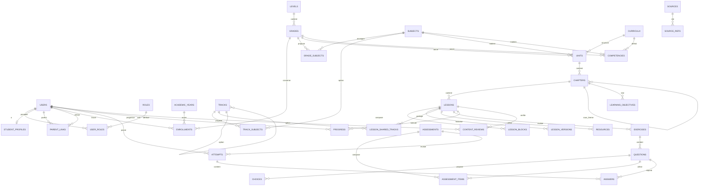
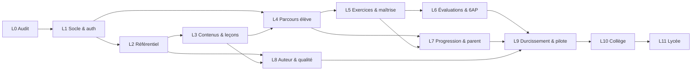

# Plan directeur — Plateforme e-learning Maroc

| | |
|---|---|
| **Statut** | Phase 0 — analyse & conception (aucune refonte complète engagée) |
| **Périmètre de cette phase** | audit, recherche, cartographie, architecture, modèle de données, `Plan.md`, `UX.md` |
| **Périmètre produit initial** | **primaire marocain (1AP → 6AP)** ; collège et lycée préparés, non implémentés |
| **Version** | 0.2 — 19 octobre 2026 (alignement sur le curriculum officiel 2021, `AnalyseData.md`) |
| **Référence UX** | [`UX.md`](./UX.md) — même version, mêmes hypothèses |
| **Règle absolue** | aucun contenu pédagogique inventé ne peut devenir un contenu de production |

> Ce document est le point d'entrée unique du développement. Il remplace toute note de cadrage antérieure. Les sections sont ancrées (`#s1` … `#s16`) pour être citées dans les tickets et les revues.

## Sommaire

- [1. Vision et objectifs du produit](#s1)
- [2. État actuel de l'application](#s2)
- [3. Méthodologie et résultats de la recherche de marché](#s3)
- [4. Analyse comparative des plateformes](#s4)
- [5. Sources documentaires et références vérifiées](#s5)
- [6. Cartographie du programme scolaire marocain](#s6)
- [7. Couverture détaillée du primaire](#s7)
- [8. Préparation du collège et du lycée](#s8)
- [9. Publics cibles et besoins identifiés](#s9)
- [10. Fonctionnalités nécessaires et priorités](#s10)
- [11. Architecture technique retenue et justification](#s11)
- [12. Modèle de données et relations principales](#s12)
- [13. Stratégie de suppression des données fictives](#s13)
- [14. Plan de développement organisé par lots](#s14)
- [15. Dépendances, risques et critères de validation](#s15)
- [16. État d'avancement et prochaines étapes](#s16)
- [Annexe A — Glossaire et conventions](#annexe-a)
- [Annexe B — Journal des décisions](#annexe-b)

---

<a id="s1"></a>
## 1. Vision et objectifs du produit

### 1.1 Vision

**eLarium** (nom de travail, à valider) est une plateforme d'apprentissage qui suit **le programme scolaire marocain**, du primaire au lycée, avec une priorité absolue au primaire. Elle transforme le programme officiel en un parcours guidé, court et régulier :

> **« Chaque élève sait quoi faire maintenant, comprend pourquoi, et voit ce qu'il a réellement acquis. »**

Le produit ne remplace pas l'école ni l'enseignant. Il donne à l'élève un entraînement structuré, à la maison ou en classe, et au parent une lecture fiable des progrès — sans surveillance intrusive.

### 1.2 Les quatre piliers

1. **Ancrage dans le programme marocain.** Chaque leçon est rattachée à un niveau, une année, une matière, une unité et un chapitre identifiables. Les références officielles sont stockées avec le contenu.
2. **Parcours guidé, pas catalogue infini.** L'élève voit une seule prochaine étape ; le chemin complet reste consultable.
3. **Maîtrise plutôt que consommation.** Une leçon « terminée » n'est pas une compétence acquise : la maîtrise se mesure par des exercices, des révisions espacées et des évaluations.
4. **Confiance des familles.** Un espace parent lisible, des contenus vérifiés par des enseignants, aucune publicité, aucune collecte inutile, protection renforcée des mineurs.

### 1.3 Objectifs de la première année

| Objectif | Indicateur | Cible réaliste à 12 mois |
|---|---|---|
| Couvrir le primaire | Part des séquences 1AP–6AP publiées et validées | 100 % des matières socles, avec **profondeur progressive** (1AP–4AP d'abord) |
| Créer une habitude | Élèves actifs / semaine | ≥ 35 % des comptes activés |
| Faire progresser | Leçons terminées avec maîtrise ≥ 70 % | ≥ 60 % des leçons commencées |
| Impliquer les parents | Comptes parents avec au moins 1 enfant relié et 1 consultation/mois | ≥ 50 % des familles |
| Qualité éditoriale | Leçons validées par un enseignant avant publication | 100 % |
| Performance | Première leçon utile sur 3G/entrée de gamme | ≤ 3 s (LCP) et poids initial ≤ 250 Ko JS compressé |
| Accessibilité | Conformité WCAG 2.2 AA sur les parcours élève/parent | 0 bloqueur critique |

> Les cibles sont des hypothèses de pilotage, pas des promesses commerciales. Elles seront révisées après le pilote (Lot 9).

### 1.4 Périmètre

| Horizon | Inclus | Explicitement exclu (pour éviter la sur-promesse) |
|---|---|---|
| **MVP primaire** | 1AP–6AP, matières socles, leçons, exercices, quiz, progression, espace parent, administration éditoriale | Cours en direct, visioconférence, messagerie libre entre mineurs, paiement en ligne, application mobile native, IA générative |
| **Phase 2** | Collège 1AC–3AC, évaluations, tableaux de bord enseignant | Lycée en même temps |
| **Phase 3** | Lycée (TC, 1Bac, 2Bac) et filières, préparation Bac | Gestion complète d'établissement (ERP) |
| **Plus tard** | Écoles partenaires, classes, devoirs assignés, contenus audio, hors-ligne | — |

Le MVP **ne dépend pas** d'un back-office complexe : l'administration éditoriale est un outil interne minimal, mais suffisamment structuré pour ne jamais publier de contenu non vérifié.

### 1.5 Contraintes structurantes

- **Langues** : arabe (RTL) et français (LTR) au minimum. L'anglais est optionnel et son statut au primaire est variable (voir §6.5). L'amazighe est à traiter comme matière à statut spécifique, non comme une hypothèse par défaut.
- **Public** : enfants de 6 à 12 ans, avec des parents souvent prescripteurs et payeurs.
- **Contexte** : connexions inégales, appareils familiaux partagés, usage fréquent du téléphone ; l'expérience doit rester utilisable sur petit écran et en faible bande passante.
- **Confiance** : données de mineurs, consentement parental, hébergement et conformité à la loi 09-08 / CNDP.
- **Évolutivité** : le modèle doit accueillir le collège et le lycée sans migration destructrice.

---

<a id="s2"></a>
## 2. État actuel de l'application

### 2.1 Ce qui existe réellement

Le dépôt contient aujourd'hui un **prototype d'interface** React, cloné d'une capture Dribbble « eLearning Platform – Web App for Teachers ». Ce n'est ni une plateforme marocaine, ni une application connectée à un backend.

| Élément | Réalité vérifiée |
|---|---|
| Frontend | Vite 5, React 18, TypeScript strict, `react-router-dom` 6, CSS par composant + tokens |
| Backend | **aucun** |
| Base de données | **aucune** |
| Authentification | **aucune** (profil de démonstration) |
| API | couche `lib/api.ts` avec `MODE_DEMO = true`, 7 fonctions simulées, délai artificiel, `?demo-erreur=1` |
| Données | jeu de démonstration entièrement fictif (groupes, élèves, copies, messages, supports) |
| Tests | 13 tests Vitest (3 fichiers) sur les parcours de l'interface |
| Design | `design.md`, `palette.md`, `animation.md` + captures `.cloneme/` |
| Langues | interface en **anglais**, typographie Poppins, orientation LTR uniquement |

### 2.2 Routes et devenir

| Route actuelle | Page | Contenu réel | Devenir |
|---|---|---|---|
| `/` | My course | groupes, planning, rappels d'un professeur fictif | **remplacer** par l'accueil élève (Lot 4) ; conserver la coque et les tokens |
| `/materials` | Materials | bibliothèque de supports fictifs | **réutiliser** le motif de bibliothèque pour les ressources de leçon (Lot 3), pas comme page principale |
| `/students` | Students | roster d'élèves fictifs | **recycler** en gestion utilisateurs/classes pour l'administration ou l'enseignant (Lot 8), hors parcours élève |
| `/reviews` | Reviews | copies à corriger fictives | **recycler** en résultats/feedback d'évaluation (Lot 6), hors MVP enfant |
| `/messages` | Messages | conversations fictives | **retirer du MVP** ; remplacé par notifications et support encadré |
| `/settings` | Settings | profil et préférences fictifs | **adapter** en profil/réglages réels (Lot 1/4) |
| `/groups/:id` | Group | détail d'un groupe fictif | **reporter** à la version enseignant/établissement (Lot 8) |
| `*` | 404 | page d'erreur | **conserver** et adapter au nouveau shell |

### 2.3 Audit des données fictives

Toutes les données ci-dessous sont inventées ou recopiées d'une image de présentation. Aucune ne doit être présentée comme un contenu de production.

| Jeu de données | Volume | Où | Usage réel | Décision |
|---|---|---|---|---|
| Profil `Elena Marsh` | 1 profil | `donneesDemo.ts` → en-tête, réglages | identité de l'interface | **supprimé du code applicatif** ; profil neutre, injecté par l'API à terme |
| Groupes | 5 | accueil, détail groupe, recherches | cartes et navigation | **déplacé en fixtures de test** |
| Élèves | 9 | students, reviews, messages | roster, copies, conversations | **déplacé en fixtures** |
| Événements | 12 | planning | emploi du temps fictif | **déplacé en fixtures** |
| Rappels | 3 | colonne de droite | démonstration d'interaction | **déplacé en fixtures** |
| Supports | 9 | materials | bibliothèque fictive | **déplacé en fixtures** |
| Évaluations | 5 | reviews | copies et notes fictives | **déplacé en fixtures** |
| Conversations | 4 (9 messages) | messages | messagerie fictive | **déplacé en fixtures** |
| Réglages | 1 | settings | préférences fictives | **remplacé par des réglages neutres** |
| Avatars | 10 photos | `public/ressources/avatars` | portraits de démonstration | **conservés comme assets de prototype**, à remplacer par les avatars utilisateurs (upload/initiales) |

**Aucune donnée pédagogique marocaine n'a été inventée dans cette phase.** La cartographie du §7 est une reconstruction documentée, pas un contenu publiable.

### 2.4 Assainissement déjà réalisé

- `ui/src/lib/donneesDemo.ts` **supprimé**.
- Le jeu de démonstration est isolé dans `ui/src/test/fixtures/donnees.ts`, avec un en-tête explicite « ne jamais importer depuis le code de production ».
- `FournisseurDonnees` démarre désormais avec des tableaux vides ; les tests injectent `JEU_DE_TEST` via `<App donneesInitiales={…} />`.
- Le profil affiché est neutre (`Compte`) tant qu'aucune authentification n'existe.
- Les pages affichent des états vides explicites (groupes, planning, rappels, supports, élèves, copies, messages).
- Les imports morts (`PROFIL_DEMO`, `Pastille` inutilisée) ont été retirés.
- **Second passage (18/10/2026)** : `lib/seances.ts` ne fabrique plus d'historique de séances (dates 2020, présences calculées) — seule la prochaine séance du groupe est affichée ; un groupe créé n'a plus d'effectif (`3`) ni de salle (`To confirm`) inventés ; un support ajouté prend la date du jour au lieu de « 17 June, 2020 » ; le lien de visio de démo ne contient plus `host=elena` ; les formulaires de création de groupe et de séance démarrent vides au lieu d'une date de 2020 pré-remplie (le test de parcours saisit désormais ses propres valeurs).
- Vérifications : `tsc` ✅, 13/13 tests ✅, build ✅, fixtures absentes du bundle de production (voir §13.4).

### 2.5 Dette restante, assumée et planifiée

| Dette | Impact | Lot de résolution |
|---|---|---|
| Interface en anglais, orientée professeur, modèle « groupes » | inadaptée au primaire marocain | Lots 4–8 |
| Dates et libellés de démonstration (« June 2020 ») dans certains composants | incohérence visible | Lot 4 (remplacement des pages) |
| `MODE_DEMO = true` et endpoints simulés | les actions ne persistent pas | Lot 1 (API réelle) puis Lot 4 |
| Aucune authentification, aucun rôle | impossible d'isoler les données | Lot 1 |
| Poppins ne couvre pas l'arabe | RTL non conforme | Lot 1 (tokens + police arabe) |
| Accessibilité non auditée | risque pour les jeunes élèves | Lot 9 (et critères dans chaque lot) |
| Captures/doc de design encore liées au clone | référence historique, pas cible produit | Lot 4 (nouvelle bibliothèque UX) |

### 2.6 Dépendances, composants et fonctionnalités simulées

**Dépendances techniques vérifiées** (`ui/package.json`) :

| Dépendance | Rôle | Décision |
|---|---|---|
| React 18 + React DOM | UI | conservé |
| react-router-dom 6 | routage | conservé, routes à revoir |
| Vite 5 + plugin React | build/dev | conservé, migré dans le monorepo |
| TypeScript 5.6 (strict) | typage | conservé |
| `@fontsource/poppins` | police latine | conservé + police arabe à ajouter |
| Vitest + jsdom + Testing Library | tests | conservé, à étendre (API/E2E) |
| Aucun UI kit, aucun state manager, aucune librairie de graphiques | — | choix à réévaluer au Lot 4 (design system maison) |
| Aucun backend, ORM, client HTTP, librairie d'auth | — | à créer au Lot 1 |

**Familles de composants** : coque (`GabaritPrincipal`, `OrnementsFond`), navigation (`BarreLaterale`, `EnTete`), cartes (`CarteGroupe`, `CarteMateriau`, `CarteEvaluation`, `CarteEvenement`, `CarteRappel`, `CarteOffre`), formulaires (`Champ`, `Bouton`, `Modale`), feedback (`Toast`, `EtatVide`, `Pastille`), messagerie (`FilMessages`), planning (`PanneauPlanning`, `SelecteurJour`), recherche (`PaletteRecherche`), profils (`Avatar`, `TableauEleves`). Le design system cible devra être extrait dans `packages/ui`.

**Fonctionnalités qui dépendent encore de données simulées** :

| Fonctionnalité | Simulation actuelle | Conséquence | Lot de remplacement |
|---|---|---|---|
| Créer un groupe | `creerGroupe` + ajout en mémoire | aucun fichier/DB | Lot 1/4 |
| Envoyer un message | `envoyerMessage` + état local | aucun envoi | retiré du MVP (notifications à la place) |
| Enregistrer les réglages | `enregistrerReglages` + état local | préférences perdues au refresh | Lot 1/7 |
| Déposer un support | `deposerMateriau` + état local | aucun upload | Lot 3 |
| Publier une évaluation | `enregistrerEvaluation` + état local | aucune note persistée | Lot 6 |
| Planifier une séance | `planifierSeance` + état local | aucun calendrier réel | Lot 8 (enseignant) |
| Créer une salle visio | `creerSeanceVisio` + lien `demo://` | aucun appel vidéo | retiré du MVP |
| Recherche globale | données en mémoire | résultats fictifs | Lot 4 |


---

<a id="s3"></a>
## 3. Méthodologie et résultats de la recherche de marché

### 3.1 Méthode

- **Recherche documentaire** : pages publiques des plateformes, pages officielles du ministère, textes de cadrage, articles de presse spécialisée.
- **Observation directe** des arborescences de cours (niveaux → matières → sections → leçons), sans contourner les paywalls ni les espaces connectés.
- **Comparaison** sur 10 critères : couverture, organisation, ressources, évaluation, suivi, rôles, modèle économique, UX, langue, accessibilité.
- **Traçabilité** : chaque affirmation est reliée à une source (§5) et marquée `Vérifié`, `Partiel` ou `À vérifier`.

**Limites** : les tableaux de bord élèves/parents derrière connexion n'ont pas été inspectés ; certains tarifs ne sont pas publics ; les programmes officiels détaillés (guides par matière) ne sont plus téléchargeables aux URL indexées (404). La cartographie du §7 est donc une **base de travail à valider** par des enseignants et inspecteurs avant publication.

### 3.2 Résultats clés

1. **Le primaire marocain dure six ans** (1AP à 6AP), avec deux cycles : fondations (1AP–2AP) puis approfondissement (3AP–6AP). Bewize décrit 34 semaines et deux semestres ; cette découpe doit être confirmée par le calendrier officiel de l'année.
2. **Les matières socles observées** sont l'arabe, le français, les mathématiques, l'activité scientifique, l'éducation islamique et l'éducation artistique. **L'histoire-géographie n'apparaît qu'à partir de la 4AP** dans l'offre AlloSchool.
3. **L'anglais n'est pas une matière primaire stable du public** : il démarre au collège, avec des expérimentations en 6AP (Casablanca-Settat, 2024-2025) et un enseignement plus précoce dans le privé. Le produit doit traiter l'anglais comme **optionnel/variable**, pas comme un socle. *Mise à jour du 19/10/2026* : le curriculum officiel 2021 l'annonce « intégré à moyen terme, après la formation des enseignants », sans programme ni volume horaire (`AnalyseData.md` V-01).
4. **L'amazighe** est en généralisation et peut être proposé à l'examen ; son statut exact par académie doit être vérifié avant toute mise en avant. *Mise à jour du 19/10/2026* : le curriculum officiel 2021 en fait une matière de 1AP à 6AP, à 3 h par semaine ; c'est son **déploiement réel** par académie qui reste à vérifier (`AnalyseData.md` V-03).
5. **L'examen de fin de primaire** (certificat d'études primaires) porte, selon le sélecteur officiel du CNEE, sur **mathématiques, arabe + éducation islamique, et français** ; l'amazighe est optionnelle selon Bewize. La science et l'histoire-géographie ne figurent pas dans ce sélecteur.
6. **L'offre gratuite est abondante mais peu guidée** : AlloSchool et TelmidTICE donnent des cours, vidéos et corrigés, mais ne construisent pas un parcours personnalisé ni un suivi parent.
7. **Les produits les plus engageants sont étroits** : Bewize couvre quatre matières avec une excellente expérience enfant, mais pas l'éducation islamique, la science ni l'histoire-géographie.
8. **Le live est cher et synchrone** : IMEL vend un accompagnement humain de qualité, mais à 70–135 €/mois, avec des créneaux fixes.
9. **Les parents demandent de la visibilité, pas de la surveillance** : les pages Bewize formulent explicitement ce besoin (progression, lacunes, recommandations, historique).
10. **L'opportunité est l'intersection** : couverture complète du primaire marocain + parcours guidé + maîtrise + espace parent + prix accessible + bilingue AR/FR.

### 3.3 Signaux à ne pas surinterpréter

- Les témoignages et chiffres marketing des plateformes (« 10 000 activités », « plus de 10 000 familles ») ne sont pas des preuves indépendantes.
- Les prix affichés peuvent changer ; ils sont datés dans le §4.
- Les pages publiques ne révèlent ni la qualité pédagogique réelle, ni le taux de complétion, ni la profondeur exacte des corrigés.
- Aucune donnée d'usage marocaine agrégée n'a été collectée dans cette phase : les cibles du §1.3 sont des hypothèses à tester.

---

<a id="s4"></a>
## 4. Analyse comparative des plateformes

### 4.1 Vue d'ensemble

| Plateforme | Positionnement | Niveaux | Matières | Organisation | Évaluation | Suivi | Modèle |
|---|---|---|---|---|---|---|---|
| **AlloSchool** | bibliothèque de cours et examens, gratuite + Premium | primaire → post-bac | large, par niveau | niveau → matière → sections (programme, leçons, devoirs, examens) | devoirs/examens corrigés | pas de parcours personnalisé visible | gratuit + Premium dès 100 DH/an |
| **Bewize** | application de révision ludique pour le primaire | CP → 6ème (1AP–6AP) | maths, français, arabe, anglais | niveau → matière → activités courtes | quiz corrigés, feedback élaboré | tableau de bord parent, lacunes, historique | gratuit (10 000 activités) + abonnement in-app (tarif non public) |
| **IMEL** | école en ligne avec professeurs | P1–P6, C1–C3, L1–L3 | arabe, math, français, sciences, histoire-géo, éducation islamique | cours en direct, petits groupes, emploi du temps | examens blancs, devoirs | suivi professeur + réunions parents | 70 €/mois (P1–P4), 110 €/mois (P5–P6 et collège), 135 €/mois (lycée) |
| **TelmidTICE** | ressources numériques officielles | primaire, collège, lycée | toutes matières | vidéos, résumés, exercices, classés par niveau | exercices/corrigés selon ressources | aucun suivi personnel | gratuit, officiel |
| **KoolSkools** | plateforme d'établissement | écoles | selon établissement | espaces élèves, cours, devoirs, notes, emploi du temps, messages | selon établissement | notes et suivi scolaire | B2B, tarif non public |
| **Profey** | marketplace de professeurs particuliers | primaire → bac | toutes matières | mise en relation, profils, réservation | selon professeur | aucun suivi produit | commission/services, tarif non public |
| **Massar / Moutamadris / Wali** | système d'information scolaire officiel | primaire → lycée | — | notes, absences, examens, inscription | résultats officiels | portail élève/parent | gratuit, administratif |

> Les lignes « tarif non public » ne sont pas des inférences : l'information n'a pas été accessible publiquement lors de la recherche.

### 4.2 AlloSchool — la référence de contenu

**Vérifié sur** : [page Primaire](https://www.alloschool.com/category/primary), pages de cours 1AP/6AP, [page Premium](https://www.alloschool.com/publication/alloschool-premium) (consultées en octobre 2026).

- **Couverture** : six années primaires, puis collège, lycée, post-bac. Pour chaque année, les matières sont listées avec leurs cours ; l'histoire-géographie apparaît en 4AP, 5AP et 6AP.
- **Organisation** : chaque cours est découpé en sections : programme pédagogique/distribution annuelle, fiches pédagogiques, leçons, devoirs du premier et du second semestre, examens locaux/provinciaux pour la 6AP, parfois contenu Premium.
- **Ressources** : PDF, vidéos, exercices, corrigés, sujets d'examens. La 6AP expose des sujets locaux et provinciaux corrigés.
- **Évaluation** : devoirs et examens, mais pas de moteur adaptatif ni de maîtrise par compétence.
- **Suivi** : aucun tableau de bord personnel visible publiquement ; l'expérience est celle d'une bibliothèque.
- **Modèle** : ressources gratuites + Premium (vidéos de cours détaillés, exercices et examens corrigés), à partir de 100 DH/an pour le primaire 5AP/6AP ; paiement carte, WafaCash, virement.
- **Forces** : profondeur de contenu, couverture, gratuité, examens corrigés, référence connue des familles.
- **Limites** : navigation dense, pas de parcours guidé, pas de suivi parent, qualité hétérogène, dépendance à la recherche, expérience peu adaptée aux jeunes enfants, publicités/offres.
- **Opportunité** : ne pas concurrencer le catalogue ; s'appuyer sur des sources officielles et offrir **la couche de guidage, de maîtrise et de confiance** qui manque.

### 4.3 Bewize — la meilleure expérience enfant

**Vérifié sur** : [programme primaire](https://bewize.ma/fr/programme-scolaire-primaire-maroc), pages [CP](https://bewize.ma/fr/levels/cp)/[CE1](https://bewize.ma/fr/levels/ce1)/[CE2](https://bewize.ma/fr/levels/ce2)/[CM2](https://bewize.ma/fr/levels/cm2)/[6ème](https://bewize.ma/fr/levels/6eme), [« Comment ça marche »](https://bewize.ma/fr/comment-ca-marche), [« Espace parents »](https://bewize.ma/fr/parents) (octobre 2026).

- **Couverture** : CP à 6ème, quatre matières (maths, français, arabe, anglais). Pas d'éducation islamique, de science, d'histoire-géographie ni d'arts.
- **Organisation** : sessions de 10–15 min, activités interactives, quiz, flashcards, consignes audio, progression en spirale, taxonomie de Bloom revendiquée.
- **Évaluation** : feedback élaboré après chaque réponse, quiz corrigés, reprise des erreurs.
- **Suivi** : tableau de bord parent avec progression par matière, lacunes, recommandations, historique ; limites de temps configurables.
- **Modèle** : plus de 10 000 activités gratuites, abonnement in-app dont le prix n'est pas public ; conformité CNDP déclarée (D-994/2023) et hébergement Scaleway France.
- **Forces** : UX enfantine, motivation, feedback, voix/audio, tableau de bord parent, promesse de sessions courtes.
- **Limites** : couverture partielle du programme, anglais traité comme matière alors qu'il est variable au public, pas d'outils enseignant, application mobile avant tout, pas de préparation complète à l'examen 6AP.
- **Opportunité** : reprendre les principes (court, bienveillant, feedback, parent) mais avec **toutes** les matières socles et un ancrage explicite au programme.

### 4.4 IMEL — l'accompagnement humain

**Vérifié sur** : programmes [primaire P1–P4](https://www.imel.ma/programmes/primaire), [P5–P6](https://www.imel.ma/programmes/primaire-p5-p6), [collège](https://www.imel.ma/programmes/college), [lycée](https://www.imel.ma/programmes/lycee), tarifs (octobre 2026).

- **Couverture** : primaire, collège, lycée ; arabe, mathématiques, français, sciences, histoire-géographie, éducation islamique ; Coran/Dine offert.
- **Organisation** : cours en direct sur Google Meet, 5 jours/semaine, séances de 55 min (primaire) ou 1h25 (selon niveau), petits groupes de 6 à 7 élèves, enseignants spécialisés, réunions parents-professeurs quatre fois par an.
- **Évaluation** : examens blancs réguliers, plateforme de devoirs, préparation aux examens officiels.
- **Suivi** : professeur principal, mentorat, espace parent (dashboard).
- **Modèle** : 70 €/mois en P1–P4, 110 €/mois en P5–P6 et au collège, 135 €/mois au lycée ; inscription 20 € ; remises trimestrielles/annuelles.
- **Forces** : qualité humaine, couverture complète, préparation aux examens, structure rassurante.
- **Limites** : coût élevé, synchronous, places limitées, fuseaux horaires, dépendance à la disponibilité, peu de self-service gratuit.
- **Opportunité** : proposer le complément asynchrone/abordable qui ne remplace pas le professeur mais libère du temps de classe et rassure les familles.

### 4.5 TelmidTICE, KoolSkools, Profey, Massar

- **TelmidTICE** (officiel) : [ressources vidéo, résumés, exercices et corrigés](https://telmidtice.men.gov.ma/) pour tous les niveaux, en arabe et en français, utilisé notamment pour l'enseignement à distance. C'est une **source de référence et un canal de distribution**, pas un concurrent direct sur l'expérience personnalisée.
- **KoolSkools** ([site](https://www.koolskools.com/)) : plateforme utilisée par des établissements marocains pour les espaces élèves, cours, devoirs, notes, emploi du temps et échanges avec les enseignants. C'est un **outil B2B d'établissement**, pas une plateforme grand public de contenu. Source secondaire (Famille Actuelle), fonctionnalités non toutes vérifiées.
- **Profey** : marketplace de professeurs particuliers (primaire à bac), réservation et profils vérifiés. C'est un **service de mise en relation**, sans parcours pédagogique structuré. Source secondaire.
- **Massar / Moutamadris / Wali** : système officiel de notes, absences, examens et inscription. Ce n'est pas un produit e-learning ; c'est une **source de vérité administrative** et un point d'intégration futur (import de classe, résultats), jamais un remplacement.


| Plateforme | Forces | Limites | Opportunité pour eLarium |
|---|---|---|---|
| **TelmidTICE** | gratuit, officiel, couverture large, ressources AR/FR | bibliothèque statique, pas de parcours ni de suivi, interface datée | s'en inspirer comme source et complément, pas comme concurrent |
| **KoolSkools** | intégré à la vie scolaire, notes/devoirs/emploi du temps, relation enseignants | B2B, dépend de l'établissement, pas de contenu grand public | futur partenariat écoles, pas un concurrent direct |
| **Profey** | accès à des professeurs vérifiés, souple | pas de programme structuré ni de suivi produit, qualité variable | complément humain pour les familles qui veulent un professeur |
| **Massar / Moutamadris / Wali** | source officielle des notes et inscriptions | administratif, pas pedagogique, accès encadré | intégration/export plus tard, jamais remplacement |

### 4.6 Matrice de différenciation

| Capacité | AlloSchool | Bewize | IMEL | TelmidTICE | Cible MVP |
|---|---|---|---|---|---|
| Programme primaire complet (matières socles) | ✅ | ⚠️ 4 matières | ✅ | ✅ | ✅ |
| Leçons structurées par unité/chapitre | ✅ (sections) | ⚠️ activités | ⚠️ cours live | ⚠️ ressources | ✅ |
| Exercices corrigés | ✅ | ✅ | ✅ | ⚠️ | ✅ |
| Maîtrise par compétence | — | ✅ | ⚠️ professeur | — | ✅ |
| Parcours guidé « prochaine étape » | — | ✅ | ⚠️ | — | ✅ |
| Suivi parent | — | ✅ | ✅ | — | ✅ |
| Rôles enseignant/admin | — | — | ✅ | — | ✅ (admin/éditorial) |
| Bilingue AR/FR + RTL | ⚠️ contenus | ⚠️ interface | ⚠️ | ✅ | ✅ |
| Préparation examen 6AP | ✅ | ⚠️ 3 matières | ✅ | ⚠️ | ✅ |
| Gratuité d'entrée | ✅ | ✅ | — | ✅ | ✅ (freemium) |
| Faible bande passante | ⚠️ | ⚠️ app | ⚠️ live | ⚠️ | ✅ |
| Prix accessible | ✅ | ⚠️ inconnu | — | ✅ | ✅ |

Légende : ✅ vérifié/oui ; ⚠️ partiel ou à vérifier ; — absent/non observé.

### 4.7 Opportunités concrètes

1. **Le chaînon manquant** : un parcours guidé, bilingue, complet, avec maîtrise et espace parent, à un prix inférieur au live.
2. **La confiance éditoriale** : afficher la source, la version du programme, le nom du relecteur et la date de validation.
3. **Le lien avec l'école** : ne pas remplacer Massar ; exporter/inporter les résultats, préparer l'enseignant à utiliser les données.
4. **Le mobile-first réel** : sessions courtes, audio, téléchargement, faible consommation.
5. **L'examen 6AP** : un parcours de préparation ciblé sur les trois épreuves officielles, avec sujets blancs et feedback.
6. **Les parents** : un rapport hebdomadaire lisible, sans notation anxiogène, avec des actions concrètes.

---

<a id="s5"></a>
## 5. Sources documentaires et références vérifiées

### 5.1 Niveaux de confiance

| Niveau | Signification |
|---|---|
| **A — Officiel vérifié** | page/PDF d'une institution marocaine, consultée directement |
| **B — Plateforme vérifiée** | page publique d'une plateforme, consultée directement, information produit |
| **C — Presse/secondaire** | article de presse ou annuaire, information recoupée mais non officielle |
| **D — À vérifier** | information incomplète, contradictoire ou non accessible |

### 5.2 Sources principales

| ID | Source | Type | Ce qui a été vérifié | Niveau | Accès |
|---|---|---|---|---|---|
| S01 | [MEN — portail officiel](https://www.men.gov.ma/) | officiel | existence du ministère, services numériques, actualités | A | 200 |
| S02 | [MEN — documents officiels](https://www.men.gov.ma/fr/documents-officiels) | officiel | documents de référence, cadrage, textes | A | 200 |
| S03 | [Vision stratégique 2015–2030 (PDF)](https://www.men.gov.ma/sites/default/files/2026-02/Vision_strateg_CSE%20Fr.pdf) | officiel | cadre stratégique de la réforme | A | 200 |
| S04 | [Loi-cadre 51.17 (PDF)](https://www.men.gov.ma/sites/default/files/2026-02/loi%20cadre.pdf) | officiel | cadre juridique du système éducatif | A | 200 |
| S05 | [CNEE — examens certificatifs](https://cnee.men.gov.ma/) | officiel | portail des sujets d'examens | A | 200 |
| S06 | [CNEE — sujets du primaire](https://cnee.men.gov.ma/WebPrim.aspx) | officiel | sélecteur de matières : mathématiques, arabe + éducation islamique, français | A | 200 |
| S07 | [TelmidTICE](https://telmidtice.men.gov.ma/) | officiel | plateforme de ressources, toutes niveaux | A | 200 (interface dynamique) |
| S08 | [Massar Waliye](https://massarservice.men.gov.ma/waliye/Account) | officiel | portail parent | A | accessible |
| S09 | [Massar Moutamadris](https://massarservice.men.gov.ma/moutamadris/Account) | officiel | portail élève | A | accessible |
| S10 | [AlloSchool — Primaire](https://www.alloschool.com/category/primary) | plateforme | 6 années, matières par année, histoire-géo à partir de la 4AP | B | 200 |
| S11 | [AlloSchool — Mathématiques 1AP](https://www.alloschool.com/course/alriadhiat-alaol-ibtdaii) | plateforme | séquences de mathématiques 1AP | B | 200 |
| S12 | [AlloSchool — Français 1AP](https://www.alloschool.com/course/francais-1ere-annee-primaire) | plateforme | alphabet, sons, périodes, vocabulaire | B | 200 |
| S13 | [AlloSchool — Arabe 6AP](https://www.alloschool.com/course/allgha-alarbia-alsads-abtdaii) | plateforme | grammaire, morphologie, orthographe, examens | B | 200 |
| S14 | [AlloSchool — Histoire-Géographie 6AP](https://www.alloschool.com/course/alijtmaaiat-alsads-abtdaii) | plateforme | histoire, géographie, citoyenneté | B | 200 |
| S15 | [AlloSchool Premium](https://www.alloschool.com/publication/alloschool-premium) | plateforme | offre payante, paiement, 100 DH/an | B | 200 |
| S16 | [AlloSchool — Collège](https://www.alloschool.com/category/middle-school) | plateforme | 1AC–3AC, matières | B | 200 |
| S17 | [AlloSchool — Lycée](https://www.alloschool.com/category/high-school) | plateforme | TC, 1Bac, 2Bac, filières | B | 200 |
| S18 | [Bewize — programme primaire](https://bewize.ma/fr/programme-scolaire-primaire-maroc) | plateforme | 6 niveaux, 2 cycles, 34 semaines, matières, examen, anglais | B | 200 |
| S19 | [Bewize — CP](https://bewize.ma/fr/levels/cp) | plateforme | objectifs CP, 10 min, audio | B | 200 |
| S20 | [Bewize — CE1](https://bewize.ma/fr/levels/ce1) | plateforme | nombres jusqu'à 1 000, français, anglais | B | 200 |
| S21 | [Bewize — CE2](https://bewize.ma/fr/levels/ce2) | plateforme | multiplication/division, conjugaison | B | 200 |
| S22 | [Bewize — CM2](https://bewize.ma/fr/levels/cm2) | plateforme | décimaux, proportionnalité, rédaction | B | 200 |
| S23 | [Bewize — 6ème](https://bewize.ma/fr/levels/6eme) | plateforme | examen, matières, anglais | B | 200 |
| S24 | [Bewize — méthode](https://bewize.ma/fr/comment-ca-marche) | plateforme | spiral, Bloom, feedback, gamification, dashboard | B | 200 |
| S25 | [Bewize — espace parents](https://bewize.ma/fr/parents) | plateforme | dashboard, lacunes, CNDP, données | B | 200 |
| S26 | [IMEL — primaire P1–P4](https://www.imel.ma/programmes/primaire) | plateforme | matières, 4 séances, 55 min, tarifs | B | 200 |
| S27 | [IMEL — primaire P5–P6](https://www.imel.ma/programmes/primaire-p5-p6) | plateforme | matières, examen, tarifs | B | 200 |
| S28 | [IMEL — collège](https://www.imel.ma/programmes/college) | plateforme | matières, 3AC, tarifs | B | 200 |
| S29 | [IMEL — lycée](https://www.imel.ma/programmes/lycee) | plateforme | TC, Sciences Expérimentales, Bac | B | 200 |
| S30 | [Famille Actuelle — plateformes locales](https://familleactuelle.ma/podcasts-applis-plateformes-locales-nos-allies-pour-une-rentree-futee/) | presse | KoolSkools, Profey, Bewize | C | 200 |
| S31 | [Hespress — pilote anglais 6AP](https://en.hespress.com/86248-casablanca-settat-region-to-pilot-english-in-primary-schools.html?print) | presse | anglais public au collège, pilote 6AP | C | 200 |
| S32 | [TelQuel — généralisation anglais](https://telquel.ma/instant-t/2023/09/20/le-ministere-de-leducation-devoile-son-programme-pour-generaliser-langlais-au-primaire_1832417/) | presse | ressources anglais, 10 % des établissements | C | 200 |
| S33 | [Massar Service — TelmidTICE](https://www.massar-service.ma/telmidtice-men-gov-ma) | secondaire | description des ressources TelmidTICE | C | 200 |
| S34 | [KoolSkools](https://www.koolskools.com/) | plateforme | page accessible mais contenu dynamique non lisible | D | 200 |
| S35 | [Profey](https://www.profey.ma/) | plateforme | non accessible lors de la recherche | D | échec |

### 5.3 Sources officielles inaccessibles (à retrouver)

Les documents officiels détaillés par matière (guides de l'enseignant, programmes, cadres de référence 2025) sont indexés par les moteurs de recherche mais les URL `men.gov.ma/Ar/Documents/...` testées renvoient **404** en octobre 2026. Ils doivent être obtenus auprès de la Direction des curricula ou via une archive officielle avant la production de contenu.

**Conséquence** : la cartographie du §7 ne cite pas ces PDF comme preuve directe ; elle s'appuie sur les plateformes alignées (niveau B) et sur le cadre officiel général (niveau A). Les objectifs formulés sont des reformulations de travail, à valider.

### 5.4 À vérifier avant le Lot 2

- [x] Liste officielle des matières par année (1AP–6AP) : curriculum du primaire 2021, p. 34 (`AnalyseData.md` D-02, obtenu par un miroir).
- [ ] Volumes horaires par année : extraits de D-02 p. 45, **ordre des colonnes à confirmer visuellement**.
- [ ] Déploiement réel de l'amazighe et intégration de l'anglais par académie pour 2026-2027 (le programme de l'amazighe existe ; celui de l'anglais non).
- [ ] Structure officielle des unités/chapitres par manuel agréé.
- [ ] Format, durée, coefficients et barème de l'examen 6AP 2027.
- [ ] Programmes détaillés du collège et du lycée par filière.
- [ ] Conditions d'utilisation des manuels scolaires et des ressources TelmidTICE/AlloSchool (droits).
- [ ] Cadre CNDP applicable aux données de mineurs et au consentement parental.


---

<a id="s6"></a>
## 6. Cartographie du programme scolaire marocain

### 6.1 Conventions de nommage

| Concept | Convention | Exemple |
|---|---|---|
| Niveau | `PRIMAIRE`, `COLLEGE`, `LYCEE` | — |
| Année | code officiel marocain + libellé français | `1AP` = CP ; `6AP` = 6ème |
| Cycle primaire | `FONDATIONS` (1AP–2AP), `APPROFONDISSEMENT` (3AP–6AP) | hypothèse de travail, à confirmer |
| Matière | code stable + libellés AR/FR | `ARABE`, `FRANCAIS`, `MATH`, `SCIENCES`, `ISLAMIQUE`, `SOCIAL`, `ART`, `EPS`, `COMPETENCES_VIE`, `ANGLAIS`, `AMAZIGHE` |
| Unité | grand thème du manuel/programme | « Nombres et calcul », « Lire et écrire » |
| Chapitre | sous-thème | « Les nombres de 0 à 10 » |
| Leçon | séance pédagogique | « Comparer des quantités » |
| Ressource | support lié | vidéo, PDF, audio, image |
| Exercice | activité d'entraînement | QCM, réponse courte, appariement |
| Évaluation | contrôle/quiz/examen | quiz de chapitre, examen blanc 6AP |

**Règle de modélisation** : une leçon appartient à **un seul** chapitre ; un chapitre à **une seule** unité ; une unité à **un seul** couple (année, matière) et, au lycée, à une **filière** optionnelle. Le contenu peut être partagé entre filières via une table de liaison, jamais par duplication silencieuse.

**Exemple de découpage proposé (à valider)** — 1AP mathématiques : unité 1 « Nombres de 0 à 10 » (chapitres : compter, écrire, comparer) ; unité 2 « Premières opérations » (addition, soustraction) ; unité 3 « Grandeurs et formes » (longueurs, figures). Ce découpage illustre la structure cible ; il ne remplace pas le manuel officiel.

### 6.2 Matrice du primaire

| Année | Arabe | Français | Mathématiques | Activité scientifique | Éducation islamique | Histoire-Géographie | Éducation artistique | Compétences de vie | Anglais | Amazighe |
|---|---|---|---|---|---|---|---|---|---|---|
| 1AP | ✅ | ✅ | ✅ | ✅ | ✅ | — | ✅ | ✅ | non programmé | ✅ (3 h) |
| 2AP | ✅ | ✅ | ✅ | ✅ | ✅ | — | ✅ | ✅ | non programmé | ✅ (3 h) |
| 3AP | ✅ | ✅ | ✅ | ✅ | ✅ | — | ✅ | ✅ | non programmé | ✅ (3 h) |
| 4AP | ✅ | ✅ | ✅ | ✅ | ✅ | ✅ | ✅ | ✅ | non programmé | ✅ (3 h) |
| 5AP | ✅ | ✅ | ✅ | ✅ | ✅ | ✅ | ✅ | ✅ | non programmé | ✅ (3 h) |
| 6AP | ✅ | ✅ | ✅ | ✅ | ✅ | ✅ | ✅ | ✅ | pilote (presse) | ✅ (3 h) ; option à l'examen |

Sources : **curriculum officiel du primaire 2021**, p. 34 et 45 (`AnalyseData.md` D-02, Direction des curricula, obtenu par un miroir) pour la liste des matières par année ; AlloSchool Primaire (S10) en recoupement ; CNEE (S06) pour les matières évaluées à l'examen ; Bewize (S18, S23) et la presse (S31, S32) pour le pilote d'anglais en 6AP. L'éducation physique figure aussi au curriculum, de 1AP à 6AP ; elle reste hors MVP (§6.5).

**Mise à jour du 19/10/2026** (`AnalyseData.md` §6 et §8) :

- **V-01 — Anglais** : le curriculum l'annonce « intégré à moyen terme » (six ans après le début de la réforme), sans programme ni volume horaire. La colonne n'est plus « optionnel/variable » mais **non programmé** ; la matière reste désactivable par année et par académie.
- **V-02 — Compétences de vie** (المهارات الحياتية) : matière officielle de 1AP à 6AP (30 min par semaine), avec des activités dédiées. **Ajoutée** au référentiel (code `COMPETENCES_VIE`).
- **V-03 — Amazighe** : matière officielle de 1AP à 6AP, 3 h par semaine. Le programme existe ; reste à vérifier son déploiement réel par académie.
- **V-04 — Langue d'enseignement** : les mathématiques, l'activité scientifique et les compétences de vie sont enseignées en **arabe / français** selon le curriculum. La langue d'enseignement est donc portée par l'offre (année × matière), et c'est une **liste** (§12.3, `grade_subjects.teaching_languages`).

Les colonnes Anglais/Amazighe restent **activables** par année et par académie.

### 6.3 Collège (1AC–3AC)

Structure observée sur AlloSchool (S16) :

| Année | Matières |
|---|---|
| 1AC | Arabe, français, anglais, mathématiques (AR/FR), physique-chimie, SVT, histoire-géographie, éducation islamique, informatique ; arts et EPS selon l'établissement |
| 2AC | idem + technologie industrielle ; arts et EPS selon l'établissement |
| 3AC | idem + technologie industrielle ; préparation à l'examen régional ; arts et EPS selon l'établissement |

- Le collège dure **trois ans** (1AC, 2AC, 3AC).
- Les mathématiques et les sciences sont proposées en arabe et en français selon les filières/établissements ; le modèle doit stocker la **langue d'enseignement** au niveau de l'offre, pas seulement de la ressource.
- L'examen régional de 3AC et le baccalauréat ne sont pas détaillés ici : à documenter au Lot 10.

### 6.4 Lycée

Structure observée (S17) :

| Cycle | Filières / options |
|---|---|
| Tronc Commun | Sciences ; Technologies ; Lettres et Sciences Humaines |
| 1ère Bac | Sciences Mathématiques ; Sciences Expérimentales ; Sciences et Technologies Électriques ; Sciences et Technologies Mécaniques ; Sciences Économiques et Gestion ; Lettres et Sciences Humaines |
| 2ème Bac | Sciences Mathématiques A/B ; Sciences Physiques ; SVT ; Sciences Agronomiques ; Sciences et Technologies Électriques/Mécaniques ; Sciences Économiques ; Sciences de Gestion Comptable ; Lettres ; Sciences Humaines |

- Le lycée dure **trois ans** (TC, 1Bac, 2Bac) et se termine par le baccalauréat.
- Les matières dépendent fortement de la filière ; le modèle doit donc gérer des **filières** (`tracks`) et des **matières de filière** (`track_subjects`) sans dupliquer les référentiels.
- **Aucun contenu de lycée n'est cartographié dans cette phase.** Le Lot 11 devra reprendre la méthode du primaire, avec validation officielle.

### 6.5 Points de vigilance sur le programme

| Sujet | Ce qui est établi | Ce qui reste à vérifier | Décision produit |
|---|---|---|---|
| Découpage annuel | 34 semaines, 2 semestres (Bewize, S18) | calendrier officiel 2026-2027 | afficher le semestre, pas une semaine rigide |
| Anglais | curriculum 2021 : « intégré à moyen terme », sans programme (V-01) ; public : collège + pilote 6AP ; privé : plus tôt | calendrier d'intégration, académies | matière **non programmée** au primaire, désactivée par défaut |
| Amazighe | matière officielle 1AP–6AP, 3 h par semaine (curriculum 2021, V-03) ; option à l'examen (Bewize) | déploiement réel par académie, épreuve | présente au référentiel ; activation par académie |
| Compétences de vie | matière officielle 1AP–6AP, 30 min par semaine (curriculum 2021, V-02) | contenu des activités par année | ajoutée au référentiel ; format court, sans évaluation notée |
| Langue d'enseignement | maths, activité scientifique et compétences de vie : arabe / français (curriculum 2021, V-04) | pratique réelle par établissement | langue portée par l'offre année × matière, sous forme de liste |
| Histoire-Géo | à partir de la 4AP (AlloSchool, confirmé par le curriculum 2021) | — | activer à partir de la 4AP |
| Éducation artistique | présente (AlloSchool) | séquences/objectifs officiels | prévoir des activités courtes, sans évaluation notée |
| EPS | présente à l'école | intégration numérique non pertinente | hors MVP |
| Éducation islamique | présente et évaluée à l'examen | programme par année | incluse, avec relecture par un enseignant qualifié |
| Examens | 6AP : arabe + islamique, français, math (CNEE) | barème, durée, coefficients 2027 | préparer les 3 épreuves, ne pas inventer le barème |

---

<a id="s7"></a>
## 7. Couverture détaillée du primaire

**Sources par année** : 1AP — S11, S12 ; 2AP — S10, S20 ; 3AP — S10, S21 ; 4AP — S10 ; 5AP — S10 ; 6AP — S10, S13, S14 ; examen — S06, S23. Les références complètes sont au §5.

> **Statut de cette section.** Reconstruction de travail à partir de sources alignées (principalement AlloSchool, S10–S14) et de sources officielles générales. Les intitulés de séquences sont ceux publiés par la plateforme, traduits et regroupés ; les objectifs sont des reformulations de compétences. **Ils ne constituent pas un texte officiel** et doivent être validés par un inspecteur/enseignant avant publication. Les cases « à compléter » sont des manques assumés, pas des contenus inventés.

### 7.1 1AP (CP) — construire les fondations

**Finalité** : entrer dans la lecture, l'écriture et le calcul ; découvrir le monde et les premières valeurs.

| Matière | Unités, chapitres et séquences observés | Objectifs de fin d’année |
|---|---|---|
| **Arabe** | Alphabet arabe (28 lettres), voyelles courtes et longues, syllabes, lecture et écriture des lettres, premiers mots, expression orale, contes | Reconnaître et écrire les lettres ; lire des syllabes et des mots simples ; s'exprimer oralement |
| **Français** | Alphabet, sons et graphies (périodes 1 à 4 : a, o, i, m, e, n, r, l, u, é, b, p, d, t, v, s, f, ch, ou, on, an, gn, ill…), syllabes, premiers mots, vocabulaire illustré | Déchiffrer des syllabes et des mots simples ; écrire des lettres ; comprendre des consignes courtes |
| **Mathématiques** | Nombres 0 à 10, comptage de petites quantités, suite numérique, écritures d'un nombre, comparaison de longueurs, situations d'addition et de soustraction, symboles + et = | Compter, lire et écrire les nombres jusqu'à 10 ; comparer des quantités ; résoudre des situations simples |
| **Activité scientifique** | Temps, eau, lumière et ombre, types de corps, alimentation humaine et animale, respiration, reproduction animale, sens, mouvements, nature au fil des saisons | Observer, nommer et décrire des phénomènes proches ; adopter des gestes d'hygiène |
| **Éducation islamique** | Sourates courtes (Al-Fatiha, At-Tin, Quraysh, Al-Ikhlas, Al-Fil, Al-Kafirun, Al-Falaq, An-Nas, Al-Qadr, Ad-Duha), foi (Dieu créateur), vie du Prophète, ablutions et prière, valeurs, propreté et environnement | Mémoriser et comprendre des sourates courtes ; connaître les premiers gestes du culte ; respecter les autres et l'environnement |
| **Histoire-Géographie** | Non enseignée en 1AP dans l'offre observée | — |
| **Éducation artistique** | Arts plastiques : observation, couleurs, formes, découpage/collage (séquences non publiées) | Explorer des matériaux et des formes ; s'exprimer visuellement |
| **Anglais** | Variable selon l'établissement | Ne pas l'inclure dans le socle par défaut |

**Manques à combler** : séquences officielles d'éducation artistique ; progression exacte du manuel d'arabe ; volume horaire.

### 7.2 2AP (CE1) — consolider les automatismes

**Finalité** : lire des phrases, écrire sans erreur de copie, poser les premières opérations.

| Matière | Unités, chapitres et séquences observés | Objectifs de fin d’année |
|---|---|---|
| **Arabe** | Consolidation des lettres et voyelles, lecture de mots et de phrases, écriture, première orthographe, expression orale, lecture de petits textes | Lire couramment des phrases courtes ; copier et écrire des mots ; raconter un événement simple |
| **Français** | Consolidation des sons et graphies, syllabes, lecture de mots et de phrases, vocabulaire du quotidien, récitations | Lire des phrases simples ; écrire des mots connus ; dire une comptine |
| **Mathématiques** | Nombres jusqu'à 1 000, addition et soustraction posées avec retenue, découverte de la multiplication, longueurs, monnaie, temps, figures usuelles | Lire/écrire/comparer les nombres jusqu'à 1 000 ; poser une addition et une soustraction ; reconnaître des figures |
| **Activité scientifique** | Sens, son, digestion, mouvement et articulations, plantes, états de la matière, temps, déplacements des animaux | Décrire le corps et des phénomènes simples ; comparer des états de la matière |
| **Éducation islamique** | Suite du programme : sourates, foi, vie du Prophète, prière, valeurs (séquences non publiées sur AlloSchool) | Poursuivre la mémorisation et l'éducation morale ; accomplir les gestes du culte |
| **Histoire-Géographie** | Non enseignée en 2AP dans l'offre observée | — |
| **Éducation artistique** | Arts plastiques (à compléter) | Explorer et créer |
| **Anglais** | Variable ; Bewize le propose dès le CP/CE1 dans son application, ce qui ne prouve pas son statut officiel | Optionnel |

**Manques à combler** : séquences officielles d'arabe, d'éducation islamique et d'arts ; confirmation du programme de mathématiques (les leçons 2AP ne sont pas publiées sur AlloSchool).

### 7.3 3AP (CE2) — automatiser et structurer

**Finalité** : lire avec fluidité, multiplier et diviser, conjuguer, structurer sa langue.

| Matière | Unités, chapitres et séquences observés | Objectifs de fin d’année |
|---|---|---|
| **Arabe** | Lecture fluide, étude de textes, grammaire de base (phrase nominale/verbale), orthographe, production écrite courte | Lire et comprendre un texte court ; produire quelques phrases correctes |
| **Français** | Sons et graphies, lecture, vocabulaire, grammaire (nom, verbe, phrase), conjugaison (présent, futur, imparfait), orthographe, rédaction courte | Lire un texte de plusieurs phrases ; conjuguer les verbes usuels ; écrire un court texte |
| **Mathématiques** | Nombres jusqu'à 9 999, addition/soustraction, tables et technique de multiplication, découverte de la division, droite/segment, angle droit et perpendicularité, symétrie, carré/rectangle/triangle/cercle, solides, longueurs, masses, capacités, monnaie, heure, aire (approche) | Maîtriser les quatre opérations sur les entiers ; reconnaître et construire des figures ; mesurer |
| **Activité scientifique** | Électricité, alimentation, reproduction, respiration, mouvement, lumière, propriétés des corps, température | Décrire et comparer des phénomènes ; réaliser un circuit simple |
| **Éducation islamique** | Sourates (Al-Inshirah, Al-Asr, An-Nasr, Al-Infitar, Ash-Shams, Al-A'la, Al-Adiyat, Az-Zalzalah, Al-Buruj, Al-Kawthar, Al-Insan), foi, Prophète, prière (piliers, conditions), valeurs | Comprendre et appliquer les bases du culte ; adopter un comportement responsable |
| **Histoire-Géographie** | Non enseignée en 3AP dans l'offre observée | — |
| **Éducation artistique** | Arts plastiques (à compléter) | Créer et observer |
| **Anglais** | Variable | Optionnel |

**Manques à combler** : leçons d'arabe 3AP (non publiées), progression officielle de français (la page AlloSchool réutilise des contenus de 1AP), arts.

### 7.4 4AP (CM1) — approfondir et élargir

**Finalité** : maîtriser les nombres jusqu'au million et les décimaux, structurer la langue, découvrir l'histoire-géographie.

| Matière | Unités, chapitres et séquences observés | Objectifs de fin d’année |
|---|---|---|
| **Arabe** | Lecture et étude de textes, grammaire (types de phrases, nom, déterminants, pronoms, verbe, groupes), morphologie, orthographe, expression écrite | Analyser une phrase simple ; produire un texte structuré de quelques phrases |
| **Français** | Grammaire (phrase, ponctuation, genre/nombre, déterminants, pronoms, adjectif, GN/GV, compléments), conjugaison (présent, futur, passé composé, impératif), orthographe, lecture, rédaction | Conjuguer et accorder ; lire un texte ; rédiger un texte court |
| **Mathématiques** | Nombres jusqu'à 999 999, opérations, encadrement, temps, géométrie (perpendiculaires/parallèles, quadrilatères, triangles, cercle, symétrie, solides), fractions décimales, nombres décimaux, opérations sur les décimaux, proportionnalité, longueurs, masses, aires, capacités | Maîtriser les opérations et les décimaux ; résoudre des problèmes à étapes ; calculer périmètres/aires |
| **Activité scientifique** | Changements d'état, alimentation, chaleur, mouvement, gaz, eau et nature, électricité, vertébrés, plantes, cycle de vie | Décrire, classer, expérimenter et expliquer |
| **Éducation islamique** | Sourates (Al-Insan, Al-Infitar, Al-A'la, At-Tariq, Abasa, An-Naba, Al-Layl, Al-Alaq, Al-Muzzammil, Al-Bayyinah, Al-Jumu'ah), foi, Prophète, prière (ablutions, tayammum, sunan, annulatifs, jama'a), valeurs | Comprendre les fondements ; accomplir la prière ; agir avec justice |
| **Histoire-Géographie** | Histoire : école, temps, marché, quartier, village, méthode de l'historien. Géographie : définition, métier, plan de l'école, échelle, densité, environnement, météo, localisation. Citoyenneté : santé, respect, sécurité, droits, loi, écoute, besoins, travail de groupe, recherche | Se repérer dans le temps et l'espace proche ; lire un plan ; exercer une citoyenneté réflexive |
| **Éducation artistique** | Arts plastiques (à compléter) | Créer, observer, décrire |
| **Anglais** | Variable | Optionnel |

### 7.5 5AP (CM2) — consolider avant la dernière année

**Finalité** : fractions et décimaux, textes plus longs, histoire et géographie du Maroc, préparation de la 6AP.

| Matière | Unités, chapitres et séquences observés | Objectifs de fin d’année |
|---|---|---|
| **Arabe** | Grammaire (khabar, verbes, compléments, coordination, renforcement/apposition), morphologie (verbe, nom, participe, temps/lieu), orthographe (alif, ta, hamza), expression écrite, textes | Analyser des phrases complexes ; enrichir et corriger un texte |
| **Français** | Grammaire (types de phrases, GN/GV, déterminants, compléments, pronoms, coordination, adverbe), conjugaison (groupes, temps, passé composé, imparfait), orthographe, lexique, lecture, rédaction | Conjuguer et accorder avec sûreté ; comprendre un texte long ; rédiger |
| **Mathématiques** | Grands nombres, angles, droites, multiples/diviseurs, division euclidienne, fractions (comparaison, somme, différence), décimaux, proportionnalité, périmètres/aires, cercle, symétrie, solides | Maîtriser fractions et décimaux ; résoudre des problèmes multi-étapes ; calculer périmètres et aires |
| **Activité scientifique** | Dissolution et mélanges, reproduction animale, nature, lumière, équilibre, mouvement, alimentation, analyse/synthèse de la lumière | Expérimenter, comparer, expliquer |
| **Éducation islamique** | Sourates (Al-Jumu'ah, At-Tariq, Al-Alaq, An-Nazi'at), foi, Prophète, prière (sincérité, ghousl, witr, fajr, salutation de la mosquée), valeurs | Approfondir le culte et l'éthique ; relier foi et vie quotidienne |
| **Histoire-Géographie** | Histoire : habitat, vêtement, transports, commerce, éducation, traces du passé, archives, archéologie. Géographie : cartographie, échelles, relief, courbes de niveau, climats. Citoyenneté : droits, devoirs, responsabilités, relations | Lire une carte ; situer le Maroc ; argumenter sur des questions de société |
| **Éducation artistique** | Arts plastiques (à compléter) | Créer et apprécier |
| **Anglais** | Variable | Optionnel |

### 7.6 6AP — synthèse et examen

**Finalité** : consolider tout le cycle, préparer l'examen du certificat d'études primaires.

| Matière | Unités, chapitres et séquences observés | Objectifs de fin d’année |
|---|---|---|
| **Arabe** | Grammaire (exception, nombres, compléments), morphologie (temps/lieu, comparatif, nombres, instrument, participe), orthographe (hamza, alif, ta), expression, analyse de textes, entraînement à l'examen | Analyser un texte ; produire une rédaction structurée ; réussir l'épreuve d'arabe |
| **Français** | Grammaire (phrase, classes de mots, compléments), conjugaison (temps du récit), orthographe (accords, homophones), vocabulaire, lecture, rédaction, entraînement à l'examen | Comprendre un texte long ; rédiger sans fautes majeures ; réussir l'épreuve de français |
| **Mathématiques** | Nombres entiers et décimaux, fractions, opérations, division euclidienne, proportionnalité (prix, capital, intérêt), périmètres/aires, cercle, solides (prisme, cylindre) et volumes, symétrie, angles, problèmes | Résoudre des problèmes complexes ; maîtriser les grandeurs ; réussir l'épreuve de mathématiques |
| **Activité scientifique** | Sol, électricité, circuit, pression des gaz, rotation de la Terre et saisons, énergie, facteurs de dégradation du sol | Expliquer des phénomènes ; relier science et environnement |
| **Éducation islamique** | Sourates et thèmes de foi, Prophète, culte, valeurs, examen | Mobiliser les connaissances dans une situation d'examen |
| **Histoire-Géographie** | Histoire : préhistoire, Rome et royaumes amazighs, conquête islamique, dynasties (Idrissides, Almoravides, Saadiens, Alaouites), patrimoine. Géographie : région, relief, climat, population, agriculture, tourisme, environnement, études de cas. Citoyenneté : droits de l'enfant | Situer les grandes étapes ; lire et produire une carte ; exercer une citoyenneté informée |
| **Éducation artistique** | Arts plastiques (à compléter) | Créer et apprécier |
| **Anglais** | Pilote/option | Optionnel |

**Préparation à l'examen 6AP** (d'après S06 et S23) :

- Épreuve de **mathématiques**.
- Épreuve d'**arabe + éducation islamique**.
- Épreuve de **français**.
- **Amazighe** : option à confirmer.
- La science et l'histoire-géographie ne figurent pas dans le sélecteur CNEE consulté : elles restent enseignées mais ne doivent pas être présentées comme des épreuves de l'examen sans vérification.

### 7.7 Synthèse de couverture

| Matière | 1AP | 2AP | 3AP | 4AP | 5AP | 6AP | Fiabilité |
|---|---|---|---|---|---|---|---|
| Arabe | partielle | partielle | partielle | partielle | bonne | bonne | B/C |
| Français | bonne | partielle | partielle | bonne | bonne | bonne | B |
| Mathématiques | bonne | partielle | bonne | bonne | bonne | bonne | B |
| Activité scientifique | bonne | bonne | bonne | bonne | bonne | bonne | B |
| Éducation islamique | bonne | faible | bonne | bonne | bonne | partielle | B |
| Histoire-Géographie | — | — | — | bonne | bonne | bonne | B |
| Éducation artistique | faible | faible | faible | faible | faible | faible | D |
| Compétences de vie | officielle | officielle | officielle | officielle | officielle | officielle | A-m (structure) ; contenu à extraire |
| Anglais | non programmé | non programmé | non programmé | non programmé | non programmé | pilote | C/D |
| Amazighe | officielle | officielle | officielle | officielle | officielle | officielle | A-m (structure) ; déploiement à vérifier |

**Décision de contenu** : le MVP publie d'abord les matières à fiabilité B (arabe, français, math, science, islamique, histoire-géo) et prépare les arts/anglais/amazighe en **contenu optionnel** après validation. Aucune leçon ne sera publiée sur la base d'une simple inférence.

> **Mise à jour du 19/10/2026.** Le curriculum officiel 2021 (`AnalyseData.md` D-02) donne, pour chaque matière et chaque année, la structure officielle domaines → thèmes → objectifs. Il deviendra la référence de cette synthèse une fois extrait (`Scrpt.md`). Les fiabilités « B » ci-dessus décrivent la couverture **des plateformes**, pas celle du programme officiel.

---

<a id="s8"></a>
## 8. Préparation du collège et du lycée

### 8.1 Ce qui est prêt dans le modèle

- Niveaux (`levels`), années (`grades`), matières (`subjects`), filières (`tracks`), matières de filière (`track_subjects`), unités/chapitres/leçons, ressources, exercices, évaluations, progression.
- Le primaire n'utilise pas de filière ; le collège non plus ; le lycée active `tracks`.
- Les contenus peuvent être partagés entre filières via `lesson_shared_tracks`.

### 8.2 Ce qui n'est pas encore documenté

- Programmes officiels détaillés du collège et du lycée.
- Coefficients, volumes horaires, examens régionaux/nationaux par filière.
- Manuels agréés et droits associés.
- Besoins UX spécifiques (choix de filière, orientation, préparation Bac).

### 8.3 Portes de passage

| Porte | Condition |
|---|---|
| **G1 — Collège** | primaire 1AP–6AP publié et validé ; modèle de contenu stable ; 3 mois de données d'usage ; support éditorial opérationnel |
| **G2 — Lycée** | collège 1AC–3AC publié ; gestion des filières validée ; préparation Bac cadrée avec des enseignants |
| **G3 — Écoles** | offre B2B validée juridiquement et techniquement (multi-établissement, classes, enseignants) |

Aucun lot collège/lycée ne démarre avant sa porte ; le modèle est prêt, pas le contenu.

---

<a id="s9"></a>
## 9. Publics cibles et besoins identifiés

### 9.1 Personas retenus

| Persona | Description | Besoins principaux | Droits |
|---|---|---|---|
| **Élève primaire** (6–12 ans) | utilise seul ou avec un parent ; lecture variable selon l'année | consignes courtes, audio en 1AP–2AP, une seule action à la fois, feedback bienveillant, progression visible | lire les contenus publiés, faire exercices/évaluations, voir sa progression, gérer son profil |
| **Parent / tuteur** | prescripteur et payeur ; souvent peu disponible | voir les progrès sans surveiller, comprendre les lacunes, recevoir un résumé hebdomadaire, gérer le compte et le consentement | lier un enfant, consulter ses progrès/résultats, notifications, données RGPD/CNDP |
| **Enseignant / auteur** | valide et produit les contenus | outils simples de création/révision, prévisualisation, publication contrôlée, retour des erreurs | créer/modifier en brouillon, soumettre à révision, publier si autorisé, voir les statistiques de ses contenus |
| **Administrateur éditorial** | garantit la conformité au programme | référentiel, import, file de révision, versioning, traçabilité, gestion des rôles | tout sur le contenu, utilisateurs, paramètres ; pas d'accès aux données personnelles inutiles |
| **Établissement** (phase 2) | école privée/publique partenaire | classes, enseignants, assignations, rapports | selon contrat ; hors MVP |

### 9.2 Besoins par persona (JTBD)

**Élève**
- « Quand j'ouvre l'application, je veux savoir quoi faire maintenant, pour ne pas errer. »
- « Quand je me trompe, je veux comprendre pourquoi, sans avoir honte. »
- « Quand je progresse, je veux le voir, pour continuer. »

**Parent**
- « Quand je consulte l'espace parent, je veux voir ce qui est acquis et ce qui bloque, pour aider sans harceler. »
- « Quand mon enfant utilise l'app, je veux savoir que les contenus sont conformes et sûrs. »
- « Quand je paie, je veux une offre claire, sans reconduction cachée. »

**Enseignant**
- « Quand je prépare une leçon, je veux la rattacher au programme et la réutiliser, sans ressaisir. »
- « Quand je publie, je veux être sûr que la version est validée et traçable. »

**Admin**
- « Quand le programme change, je veux versionner et retirer une leçon sans casser la progression. »
- « Quand un contenu est signalé, je veux le corriger et notifier les élèves concernés. »

### 9.3 Priorisation

| Priorité | Persona | Justification |
|---|---|---|
| P0 | Élève + parent | cœur de la valeur et de la confiance |
| P1 | Admin/enseignant auteur | sans eux, pas de contenu fiable |
| P2 | Enseignant de classe | nécessite des classes, hors MVP |
| P3 | Établissement | B2B, après validation du B2C |

### 9.4 Contraintes d'usage

- Sessions courtes (10–20 min) après l'école ; le soir et le week-end.
- Appareils partagés : comptes distincts, déconnexion facile, pas de données sensibles affichées.
- Connectivité variable : pages légères, audio compressé, reprise de session, mode hors-ligne progressif.
- Parents parfois non francophones : interface AR/FR complète, pas de texte critique uniquement en français.
- Enfants en 1AP–2AP : dépendance à l'oral ; ne pas exiger une lecture autonome.


---

<a id="s10"></a>
## 10. Fonctionnalités nécessaires et priorités

### 10.1 Priorisation MoSCoW (MVP primaire)

| Fonctionnalité | Priorité | Persona | Lot | Justification |
|---|---|---|---|---|
| Inscription, connexion, vérification e-mail | **Must** | tous | 1 | sans compte, pas de progression ni de protection |
| Rôles et permissions (élève, parent, auteur, admin) | **Must** | tous | 1 | isolation des données |
| Référentiel niveaux/années/matières | **Must** | admin | 2 | socle de tout contenu |
| Arborescence unités/chapitres/leçons | **Must** | admin, élève | 2–3 | programme navigable |
| Leçon (texte, audio, image, vidéo courte) | **Must** | élève | 3–4 | cœur pédagogique |
| Exercices corrigés (QCM, réponse courte, appariement) | **Must** | élève | 5 | entraînement et maîtrise |
| Suivi de progression par leçon | **Must** | élève, parent | 4–5 | valeur perçue |
| Espace parent (progression, lacunes, activité) | **Must** | parent | 7 | confiance et rétention |
| Recherche dans les contenus | **Should** | élève, parent | 4 | accès rapide |
| Quiz de chapitre / évaluation | **Should** | élève | 6 | consolidation |
| Préparation examen 6AP | **Should** | élève, parent | 6 | besoin fort, différenciation |
| Révisions espacées / recommandations | **Should** | élève | 5–7 | maîtrise durable |
| Notifications et résumé hebdomadaire | **Should** | parent | 7 | engagement |
| Mode faible bande passante / hors-ligne | **Could** | élève | 9 | contexte marocain |
| Audio des consignes (1AP–2AP) | **Should** | élève | 4 | autonomie des jeunes |
| Tableau de bord auteur / file de révision | **Must** | auteur, admin | 3/8 | qualité éditoriale |
| Versioning et retrait de contenu | **Must** | admin | 3 | programme changeant |
| Export des données / suppression de compte | **Must** | parent | 7 | conformité |
| Paiement en ligne | **Won't (MVP)** | parent | après pilote | valider d'abord la valeur |
| Messagerie libre élève–élève | **Won't** | — | — | risque de sécurité |
| Cours en direct | **Won't** | — | — | complexité, coût |
| Application mobile native | **Won't** | — | — | PWA responsive d'abord |
| IA générative publiée sans relecture | **Won't** | — | — | risque pédagogique et éthique |

### 10.2 Parcours fonctionnel cible

```
Inscription → choix du niveau → accueil « prochaine étape »
   → matière → unité → chapitre → leçon
   → exercices → résultat → mise à jour de la maîtrise
   → révision espacée / évaluation → progrès
Parent : liaison enfant → tableau de bord → résumé → notification
Auteur : brouillon → révision → publication → version suivante
```

### 10.3 Règles produit

- **Une seule action primaire par écran** ; les actions secondaires sont discrètes.
- **Pas de score global anxiogène** : montrer la maîtrise par notion et des progrès relatifs.
- **Pas de classement public**, pas de comparaison entre enfants.
- **Pas de publicité**, pas de vente de données.
- **Pas de contenu non validé** : un brouillon n'est jamais visible par un élève.
- **Pas de contenu généré sans source** : l'IA peut aider à rédiger un brouillon, jamais publier.
- **Pas de « streak » punitif** : la régularité est encouragée, pas la peur de perdre.

---

<a id="s11"></a>
## 11. Architecture technique retenue et justification

### 11.1 Décision

**Backend Node.js + TypeScript, NestJS (adaptateur Fastify), Prisma, PostgreSQL 16, API REST `/api/v1`.**

Le frontend React/TypeScript existant est conservé comme base de design et migré progressivement dans un monorepo. Aucun changement de langage frontend.

### 11.2 Comparaison Node.js vs FastAPI

| Critère | Node.js / NestJS + TypeScript | FastAPI / Python | Verdict pour ce projet |
|---|---|---|---|
| Cohérence avec le frontend | même langage, types partagés, un seul toolchain | deux langages, contrats à dupliquer | **Node** |
| Gestion utilisateurs/rôles | guards, décorateurs, Passport, CASL, écosystème mature | dépendances, OAuth2, permissions à structurer | **Node** (léger avantage) |
| Conception API | REST/OpenAPI, validation Zod/class-validator | OpenAPI natif, Pydantic excellent | égalité |
| Modélisation scolaire | Prisma/TypeORM, relations, migrations | SQLAlchemy/Alembic, très solide | égalité |
| Contenus/ressources | S3, files BullMQ, images, vidéo | S3, Celery, traitement média | égalité |
| Sécurité/isolation | guards, policies, audit ; écosystème | dépendances solides ; plus de configuration | **Node** |
| Performance | excellent I/O, async | excellent async, calcul plus rapide | égalité (le goulot est la DB) |
| Évolutivité | horizontale, stateless | horizontale, stateless | égalité |
| Écosystème | très large, JS/TS | très large, data/ML | égalité |
| Maintenance/déploiement | un runtime, un pipeline | deux runtimes, deux pipelines | **Node** |
| IA/automatisation future | appels API, files ; Python possible en service séparé | natif pour ML | **FastAPI** sur ce point |
| Risque de migration | nul (déjà TS) | réécriture partielle, coût | **Node** |

**Conclusion** : Node.js gagne sur la cohérence, la maintenance et le déploiement, sans bloquer l'IA. Si un besoin ML lourd apparaît (recommandation, NLP arabe, correction automatique), il sera isolé dans un **service Python** appelé par API/file, pas dans le backend principal.

### 11.3 Architecture cible

```mermaid
flowchart LR
  U[Élève / Parent] --> W[Web React + PWA]
  T[Auteur / Admin] --> A[Back-office React]
  W -->|HTTPS /api/v1| API[NestJS + Fastify]
  A -->|HTTPS /api/v1| API
  API --> PG[(PostgreSQL)]
  API --> R[(Redis : cache, files)]
  API --> S[S3 : médias]
  API --> M[Service e-mail / notifications]
  API -. futur .-> AI[Service Python IA]
  CDN[CDN] --> W
  S --> CDN
```



### 11.4 Monorepo

Gestion par **pnpm workspaces**, Node 20 LTS, un seul dépôt.

```
teachme/
├── apps/
│   ├── api/                 # NestJS + Prisma
│   ├── web/                 # React/Vite (ex-ui), élève + parent
│   └── admin/               # back-office éditorial (peut être un module de web au début)
├── packages/
│   ├── contracts/           # schémas Zod + types partagés
│   ├── config/              # eslint, tsconfig, env
│   └── ui/                  # design system (tokens, composants)
├── prisma/
│   ├── schema.prisma
│   ├── migrations/
│   └── seed.ts              # référentiel uniquement
└── docs/                    # Plan.md, UX.md, ADR
```

Le déplacement de `ui/` vers `apps/web/` se fait au Lot 1, avec un commit dédié et sans changer le comportement.

### 11.5 Modules backend

| Module | Responsabilité |
|---|---|
| `auth` | inscription, connexion, refresh, vérification e-mail, mot de passe oublié, MFA admin (plus tard) |
| `users` | profils, rôles, consentements, préférences |
| `family` | liaison parent–enfant, invitations, droits |
| `curriculum` | niveaux, années, matières, filières, unités, chapitres |
| `content` | leçons, blocs, ressources, versions, publication |
| `exercises` | banque de questions, exercices, corrections |
| `assessment` | quiz, évaluations, tentatives, résultats |
| `progress` | maîtrise, temps, reprise, révisions espacées |
| `notifications` | e-mail/in-app, résumés, préférences |
| `admin` | import, file de révision, audit, statistiques |
| `media` | upload, validation, URLs signées, transcodage |
| `search` | recherche plein texte AR/FR (PostgreSQL `tsvector` au début) |
| `health` | readiness/liveness, métriques |

### 11.6 API : conventions

- REST, JSON, versionnée `/api/v1`.
- Erreurs normalisées : `{ code, message, details?, requestId }`.
- Pagination curseur pour les listes de contenu ; pagination page pour l'administration.
- `Idempotency-Key` sur les créations sensibles (paiement plus tard, import).
- Validation d'entrée systématique (Zod/class-validator) ; sortie typée via `packages/contracts`.
- OpenAPI généré et versionné ; tests de contrat.
- Aucun contenu non publié renvoyé aux routes publiques/élève.
- Autorisation au niveau ressource : un parent ne lit que ses enfants ; un élève que ses données.

### 11.7 Authentification et rôles

- **Mot de passe** : Argon2id, politique de longueur, pas de question secrète.
- **Sessions** : access token JWT court (15 min) + refresh token rotatif en cookie `HttpOnly`, `Secure`, `SameSite=Lax` ; révocation par famille de tokens.
- **CSRF** : protection par token + vérification d'origine pour les mutations.
- **Rôles** : `ELEVE`, `PARENT`, `ENSEIGNANT`, `AUTEUR`, `ADMIN`, `SUPER_ADMIN` (les deux derniers peuvent être fusionnés au départ).
- **Permissions** : RBAC + policies (ex. `lesson:publish`, `child:read`, `curriculum:write`).
- **Inscription enfant** : compte créé par le parent ou avec consentement parental vérifié ; e-mail parent obligatoire pour les moins de 15 ans (règle à valider juridiquement).
- **Connexion** : e-mail/mot de passe au départ ; Google plus tard ; pas de numéro de téléphone comme identifiant principal (partage familial).

### 11.8 Sécurité et vie privée

- Chiffrement TLS partout, chiffrement au repos (PostgreSQL/S3).
- Secrets hors du code ; rotation ; variables d'environnement.
- Limitation de débit sur auth, recherche, upload.
- Validation des fichiers (type réel, taille, antivirus), URLs signées courtes.
- En-têtes de sécurité (CSP, HSTS, X-Content-Type-Options, Referrer-Policy).
- Journal d'audit pour les actions admin/auteur (qui, quoi, quand, version).
- Journalisation sans données personnelles sensibles ; `requestId`.
- **Loi 09-08 / CNDP** : registre des traitements, base légale, consentement parental, droits d'accès/rectification/opposition/suppression, durée de conservation, hébergement déclaré.
- Pas de traceurs publicitaires ; analytics respectueux (Plausible/Matomo auto-hébergé) avec consentement.
- Sauvegardes chiffrées, tests de restauration trimestriels.
- Politique de divulgation responsable.

### 11.9 Internationalisation et RTL

- Locales `ar-MA` (RTL) et `fr-MA` (LTR) ; anglais plus tard.
- URLs localisées (`/ar/...`, `/fr/...`) ou préfixe de locale ; contenu et interface dans la même langue par défaut.
- Champs de contenu bilingues (`title_ar`, `title_fr`, etc.) et blocs JSON par locale.
- Police : **IBM Plex Sans Arabic** (OFL) pour l'arabe, **Poppins** pour le latin ; tailles et interlignes adaptés à l'arabe (pas de `letter-spacing` négatif).
- Miroir RTL : utiliser les propriétés logiques CSS (`margin-inline`, `padding-inline`, `inset-inline`) ; icônes directionnelles à retourner.
- Nombres : chiffres arabes ou latins selon la locale et le niveau ; ne pas mélanger dans une même phrase.
- Tests visuels AR/FR sur chaque page.

### 11.10 Médias et contenus

- Stockage S3 compatible (Scaleway, OVH, AWS) ; buckets privés + URLs signées.
- Images : WebP/AVIF, tailles 320/640/1024, `srcset`, lazy loading.
- Audio : MP3/AAC compressé, transcripts, lecture avec contrôle vitesse.
- Vidéo : MP4 H.264 + poster, durée courte (≤ 5 min), sous-titres.
- PDF : réservé aux fiches imprimables ; pas de lecteur PDF lourd sur mobile.
- Chaque ressource porte : langue, licence, source, auteur, date, checksum.
- Taille maximale et quotas par rôle ; analyse antivirus.

### 11.11 Performance et exploitation

- Objectifs : LCP ≤ 3 s sur 3G, JS initial ≤ 250 Ko gzip, API p95 ≤ 300 ms pour les lectures.
- Cache HTTP/CDN pour les assets ; cache Redis pour le référentiel.
- Index PostgreSQL sur les clés de navigation (`grade_id, subject_id, position`), recherche `tsvector`.
- Déploiement Docker, CI GitHub Actions : lint → typecheck → tests → build → migration check → audit.
- Environnements `dev`, `staging`, `prod` ; migrations appliquées avant déploiement, jamais de `db push` en prod.
- Sauvegardes quotidiennes, rétention 30 jours, PITR si disponible.
- Monitoring : Sentry, logs structurés, métriques (latence, erreurs, jobs), alertes.
- Plan de reprise : RTO 4 h, RPO 24 h (à valider).

### 11.12 Intelligence artificielle (plus tard)

- Cas utiles : recommandation de révision, détection de lacunes, génération de brouillons d'exercices, aide à la rédaction de feedback.
- Interdits : publication automatique, chat ouvert avec mineurs, notation définitive sans enseignant.
- Architecture : service Python séparé, file de jobs, jeux de données anonymisés, évaluation humaine.
- Aucune dépendance IA dans le MVP.

---

<a id="s12"></a>
## 12. Modèle de données et relations principales

### 12.1 Principes

1. **Référentiel séparé du contenu** : niveaux/années/matières sont stables ; unités/chapitres/leçons sont versionnés.
2. **Provenance obligatoire** : tout contenu publié référence une source et un relecteur.
3. **Suppression logique** (`deleted_at`) pour les contenus ; jamais de suppression physique d'un contenu publié.
4. **Intégrité par la base** : clés étrangères, contraintes `CHECK`, unicité, `ON DELETE RESTRICT` pour le référentiel.
5. **Langues** : colonnes bilingues pour les libellés courts, JSONB localisé pour les blocs longs.
6. **Objectifs et provenance de première classe** *(ajout du 19/10/2026, `Scrpt.md` §7.2)* : chaque objectif d'apprentissage officiel est une ligne suivie et validée (`learning_objectives`), et toute donnée de programme pointe vers sa source (`source_refs`).
7. **Extensibilité** : `track_id` nullable, `academic_year_id` sur les inscriptions, `organization_id` nullable pour le B2B futur.

### 12.2 Diagramme entité-relation



### 12.3 Tables principales

| Table | Champs clés | Contraintes |
|---|---|---|
| `users` | `id`, `email`, `password_hash`, `locale`, `status`, `email_verified_at`, `created_at` | email unique (citext), statut enum |
| `roles` | `id`, `code`, `label` | code unique |
| `user_roles` | `user_id`, `role_id`, `scope_type`, `scope_id` | PK composite, FK cascade |
| `student_profiles` | `user_id`, `birth_date`, `grade_id`, `school_name`, `guardian_consent_at` | 1–1 user, âge cohérent |
| `parent_links` | `parent_id`, `student_id`, `relation`, `verified_at`, `status` | unique (parent, student), pas d'auto-lien |
| `levels` | `id`, `code`, `label_fr`, `label_ar`, `position` | code unique |
| `grades` | `id`, `level_id`, `code`, `label_fr`, `label_ar`, `position`, `cycle` | code unique, position unique par niveau |
| `subjects` | `id`, `code`, `label_fr`, `label_ar`, `icon`, `color`, `position` | code unique |
| `grade_subjects` | `grade_id`, `subject_id`, `is_core`, `weekly_minutes`, `teaching_languages`, `coefficient` | PK composite, minutes ≥ 0 ; `teaching_languages` : liste non vide de `language` *(19/10 : `weekly_hours` remplacé par des minutes — 8 h 30, 30 min ; langue d'enseignement ajoutée, V-04)* |
| `tracks` | `id`, `level_id`, `grade_id?`, `parent_track_id?`, `code`, `label_fr`, `label_ar`, `mapping_status` | code unique par niveau ; une option (PC, SVT, SM A/B) a un parent de la même année ; pas de cycle ; `mapping_status` : `cartographiee` ou `identifiee` |
| `track_subjects` | `track_id`, `subject_id`, `is_specialty`, `weekly_minutes`, `teaching_languages`, `coefficient` | PK composite ; mêmes règles que `grade_subjects` |
| `curricula` | `id`, `code`, `label`, `country`, `type`, `version`, `effective_from`, `status` | code+version unique ; `type` : `curriculum_type` ; un programme `adapte` a le statut `temporaire` |
| `units` | `id`, `curriculum_id`, `grade_id`, `subject_id`, `track_id?`, `code`, `title_fr`, `title_ar`, `position`, `status` | FK restrict, position unique par parent |
| `chapters` | `id`, `unit_id`, `parent_chapter_id?`, `code`, `title_fr`, `title_ar`, `position`, `status` | position unique par parent ; profondeur ≤ 2 (sous-thèmes) ; le champ texte `objectives` est remplacé par `learning_objectives` |
| `learning_objectives` | `id`, `chapter_id`, `code`, `position`, `text_ar`, `text_fr`, `text_zgh`, `key`, `status` | position unique par chapitre ; `key` = empreinte du texte normalisé, pour suivre un objectif d'une version à l'autre ; au moins une `source_ref` ; texte jamais traduit automatiquement |
| `competencies` | `id`, `curriculum_id`, `grade_id`, `subject_id`, `track_id?`, `type`, `position`, `text_ar`, `text_fr`, `status` | `type` : `competency_type` ; au moins une `source_ref` |
| `sources` | `id`, `code`, `title`, `issuer`, `collected_url`, `official_url?`, `sha256`, `collected_at`, `confidence`, `license_note` | `code` unique (`D-xx` de `AnalyseData.md`) ; `sha256` unique ; `confidence` : `source_confidence` |
| `source_refs` | `id`, `source_id`, `entity_type`, `entity_id`, `page`, `method`, `raw_excerpt` | FK `source_id` restrict ; `raw_excerpt` ≤ 300 caractères ; index (`entity_type`, `entity_id`) |
| `lessons` | `id`, `chapter_id`, `code`, `title_fr`, `title_ar`, `summary_fr`, `summary_ar`, `duration_min`, `position`, `status`, `published_at`, `version`, `source_id` | version ≥ 1, statut enum |
| `lesson_blocks` | `id`, `lesson_id`, `type`, `position`, `body_fr`, `body_ar`, `resource_id?`, `settings` | type enum, position unique par leçon |
| `lesson_versions` | `id`, `lesson_id`, `version`, `snapshot`, `created_by`, `created_at` | unique (lesson, version) |
| `lesson_shared_tracks` | `lesson_id`, `track_id` | PK composite |
| `resources` | `id`, `lesson_id?`, `type`, `storage_key`, `mime`, `size_bytes`, `language`, `license`, `source_url`, `checksum` | type enum, taille > 0 |
| `exercises` | `id`, `lesson_id?`, `chapter_id?`, `type`, `difficulty`, `bloom_level`, `prompt_fr`, `prompt_ar`, `explanation_fr`, `explanation_ar`, `status` | au moins un parent, difficulté 1–5 |
| `questions` | `id`, `exercise_id`, `code`, `type`, `prompt_fr`, `prompt_ar`, `explanation_fr`, `explanation_ar`, `points`, `position`, `version` | points > 0, version ≥ 1 |
| `choices` | `id`, `question_id`, `label_fr`, `label_ar`, `is_correct`, `feedback_fr`, `feedback_ar`, `position` | une seule bonne réponse pour QCM |
| `assessments` | `id`, `code`, `type`, `grade_id`, `subject_id`, `title_fr`, `title_ar`, `duration_min`, `max_score`, `status` | type enum, score > 0 |
| `assessment_items` | `assessment_id`, `question_id`, `points`, `position` | PK composite, points > 0 |
| `attempts` | `id`, `user_id`, `assessment_id?`, `exercise_id?`, `status`, `score`, `max_score`, `started_at`, `submitted_at` | un seul parent, score ≤ max |
| `answers` | `id`, `attempt_id`, `question_id`, `response`, `is_correct`, `score`, `feedback` | unique (attempt, question) |
| `progress` | `id`, `user_id`, `lesson_id`, `status`, `mastery`, `time_spent_s`, `next_review_at`, `interval_days`, `last_viewed_at`, `completed_at` | unique (user, lesson), mastery 0–100 |
| `review_schedule` | `id`, `user_id`, `lesson_id`, `due_at`, `interval_days`, `ease`, `last_result` | unique (user, lesson, due_at) |
| `content_reviews` | `id`, `lesson_id`, `reviewer_id`, `status`, `notes`, `decided_at` | statut enum |
| `content_gaps` | `id`, `grade_id`, `subject_id`, `description`, `source_status`, `owner_id`, `status` | statut enum |
| `content_flags` | `id`, `lesson_id`, `reporter_id`, `reason`, `status`, `resolution`, `created_at` | statut enum |
| `notifications` | `id`, `user_id`, `type`, `payload`, `read_at`, `created_at` | index user/date |
| `audit_logs` | `id`, `actor_id`, `action`, `entity_type`, `entity_id`, `before`, `after`, `created_at` | append-only |
| `academic_years` | `id`, `label`, `start_date`, `end_date`, `is_active` | une seule active |

### 12.4 Énumérations

`user_status` : `actif`, `inactif`, `suspendu`, `supprime`.
`role_code` : `eleve`, `parent`, `enseignant`, `auteur`, `admin`.
`content_status` : `brouillon`, `en_revision`, `valide`, `publie`, `retire`.
`lesson_status` : idem + `archive`.
`exercise_type` : `qcm`, `reponse_courte`, `appariement`, `ordre`, `numerique`.
`assessment_type` : `quiz_chapitre`, `controle`, `examen_blanc`.
`attempt_status` : `en_cours`, `soumis`, `corrige`, `abandonne`.
`progress_status` : `non_commence`, `en_cours`, `termine`, `maitrise`.
`resource_type` : `video`, `audio`, `image`, `pdf`, `lien`, `texte`.
`block_type` : `texte`, `image`, `audio`, `video`, `exemple`, `resume`.
`language` : `ar`, `fr`, `en`, `zgh` (+ `es`, `de`, `it` pour le lycée).
`curriculum_type` : `officiel`, `adapte`, `cadre_reference`.
`curriculum_status` : `en_vigueur`, `temporaire`, `remplace`.
`competency_type` : `cycle`, `annuelle`, `finale`.
`source_confidence` : `A`, `A_m`, `B`, `C`, `D` (définitions : `AnalyseData.md` §1.3).

### 12.5 Règles d'intégrité et validations

- Un `grade_subject` ne peut exister que si la matière est autorisée pour ce niveau (table de référence).
- Une `lesson` publiée doit avoir au moins un bloc de contenu non vide, une source et une revue `valide`.
- Une `question` QCM doit avoir exactement une `choice.is_correct = true` ; les autres types ont leurs propres validateurs applicatifs.
- Un `attempt` soumis est immuable (sauf correction admin tracée).
- `progress.mastery` est recalculée par le moteur ; jamais saisie manuellement.
- Un `parent_link` doit être accepté par les deux parties (ou créé par l'admin avec trace).
- `deleted_at` est renseigné pour tout retrait ; les routes publiques filtrent `deleted_at IS NULL` et `status = 'publie'`.
- Les positions sont uniques par parent (`unit_id`, `chapter_id`) via index partiel.
- Un contenu publié ne peut pas être supprimé s'il a des tentatives/progressions : il est `retire`, pas supprimé.
- *(19/10/2026)* Un `learning_objective` ou une `competency` ne passe en `valide` que si toutes ses `source_refs` pointent vers une source de confiance `A` ou `A_m`, et après une revue enseignant tracée.
- *(19/10/2026)* Une source `B`, `C` ou `D` peut être citée en recoupement, jamais comme seule source d'un objectif.
- *(19/10/2026)* `teaching_languages` n'est jamais vide ; une matière enseignée en arabe ou en français contient les deux codes.
- *(19/10/2026)* Une option de filière (`parent_track_id` renseigné) appartient à la même année que son parent.
- *(19/10/2026)* Un programme `adapte` ne remplace jamais un programme `officiel` en vigueur ; il coexiste avec le statut `temporaire`.

### 12.6 Index principaux

- `users(email)` unique ; `parent_links(parent_id, student_id)` unique.
- `grades(level_id, position)` ; `grade_subjects(grade_id)`.
- `units(grade_id, subject_id, position)` ; `chapters(unit_id, position)` ; `lessons(chapter_id, position)`.
- `learning_objectives(chapter_id, position)` unique ; `learning_objectives(key)` ; `competencies(grade_id, subject_id)`.
- `source_refs(entity_type, entity_id)` ; `sources(sha256)` unique ; `tracks(parent_track_id)`.
- `lessons(status, published_at)` ; `progress(user_id, lesson_id)` unique ; `review_schedule(user_id, due_at)`.
- `attempts(user_id, created_at)` ; `answers(attempt_id)`.
- `notifications(user_id, read_at, created_at)`.
- Recherche : `lessons.search_vector` (`tsvector` généré, configuration `simple` + dictionnaires AR/FR à valider).
- `audit_logs(created_at)` + index sur `entity_type, entity_id`.

### 12.7 Migrations

- Prisma Migrate ; une migration par changement de schéma, nommée et revue.
- Migrations **additives d'abord** (colonnes nullables, backfill, puis contraintes), pour permettre le déploiement sans coupure.
- Aucun `db push` en staging/prod ; `prisma migrate deploy` en CI/CD.
- Rollback : migration inverse documentée ou restauration PITR ; pas de suppression de colonne sans dépréciation préalable.
- Seed : **référentiel uniquement** (niveaux, années, matières, filières, année scolaire). Aucun contenu pédagogique de démonstration.
- Import de contenu : script idempotent, provenance obligatoire, dry-run, rapport d'erreurs.

### 12.8 Versioning des contenus

- Chaque leçon a un `version` entier et un historique (`lesson_versions`) si nécessaire.
- Une modification majeure crée une nouvelle version ; les tentatives restent liées à la version utilisée.
- Les élèves en cours de parcours peuvent terminer l'ancienne version ; les nouvelles commencent sur la nouvelle.
- Les évaluations référencent des `question_id` versionnés ; une question modifiée crée une nouvelle question (pas d'édition en place si des réponses existent).
- Un contenu retiré affiche un message neutre et redirige vers le chapitre.

### 12.9 Données manquantes (à ne pas inventer)

- Le programme officiel détaillé par unité/chapitre et par manuel.
- Les coefficients ; les volumes horaires du primaire extraits du curriculum 2021 sont à confirmer visuellement (`AnalyseData.md` §6.2).
- Le format exact de l'examen 6AP 2027.
- Les programmes de collège/lycée par filière.
- Les règles CNDP précises pour les mineurs.
- Les droits de réutilisation des manuels et ressources tierces.

Ces manques sont suivis dans le registre de contenu (Lot 2) et bloquent la publication, pas le développement technique. Ils arrivent dans `content_gaps` depuis les champs `manques[]` des JSON de `data/` (`Scrpt.md` §4 et §7.2).

---

<a id="s13"></a>
## 13. Stratégie de suppression des données fictives

### 13.1 Principe

**Aucune donnée inventée ne doit pouvoir atteindre un utilisateur en production.** Les fixtures existent uniquement pour les tests automatisés et sont isolées du code applicatif.

### 13.2 Ce qui a été fait dans cette phase

| Action | Détail | Preuve |
|---|---|---|
| Suppression du fichier de démo | `ui/src/lib/donneesDemo.ts` supprimé | `grep` : aucune référence |
| Isolation des fixtures | `ui/src/test/fixtures/donnees.ts`, en-tête explicite | import uniquement depuis `src/test/` |
| État initial vide | `FournisseurDonnees` initialise des tableaux vides | `state/Donnees.tsx` |
| Profil neutre | plus de `Elena Marsh` ; avatar initiales « Compte » | `EnTete.tsx`, `PageReglages.tsx` |
| Réglages neutres | langue français, fuseau Casablanca, notifications off | `lib/etatInitial.ts` |
| Tests préservés | 13/13 tests, injection `JEU_DE_TEST` | `npx vitest run` |
| Second passage | `seances.ts`, `Donnees.tsx`, `api.ts`, `PanneauGroupes.tsx`, `PageGroupe.tsx` : valeurs inventées retirées (historique de séances, effectif, salle, dates 2020, `host=elena`) | `grep` ; 13/13 tests ; bundle sans « To confirm » ni « elena » |
| Bundle vérifié | aucune occurrence de « Elena Marsh », « Maya Chen » ; « Marketing Basic » retiré du placeholder | `grep` sur `dist/assets/*.js` |
| Poids réduit | JS 264,7 Ko → **255,7 Ko** (build final) | `npm run build` |

### 13.3 Règles pour la suite

1. **Aucun tableau de données métier dans `src/`** hors `src/test/fixtures/`.
2. **Aucun seed de contenu** : le seed ne contient que le référentiel officiel (niveaux, années, matières).
3. **Aucune donnée de démonstration dans les migrations**.
4. **Aucun fallback silencieux** : si l'API ne renvoie rien, l'UI affiche un état vide, pas un contenu inventé.
5. **Aucun contenu généré** sans source et validation humaine.
6. **Tests** : fixtures explicites, jamais importées par l'application ; un test qui a besoin d'une donnée la déclare.
7. **Revue de code** : refuser toute PR qui importe `test/fixtures` depuis `src/` hors tests.
8. **CI** : script de garde (`grep`/ESLint `no-restricted-imports`) + scan du bundle pour les noms de fixtures.

### 13.4 Contrôles automatisables

```bash
# 1. Aucun import de fixtures hors tests
grep -rn "test/fixtures" apps/web/src --include='*.ts' --include='*.tsx' | grep -v '/test/'

# 2. Aucune chaîne de démonstration dans le bundle
grep -E "Elena Marsh|Maya Chen|Marketing Basic" apps/web/dist/assets/*.js

# 3. Le seed ne contient que le référentiel
grep -n "lesson\|exercise\|question" prisma/seed.ts
```

Ces contrôles seront intégrés à la CI au Lot 1.

### 13.5 Reste à retirer (planifié)

| Élément | Pourquoi | Lot |
|---|---|---|
| `MODE_DEMO` et réponses simulées | fausse persistance | 1 |
| Textes et dates du prototype (« June 2020 » du planning `PanneauPlanning`/`SelecteurJour`, « Groups », « New group ») | cadre fixe de l'ancienne interface, pas des données | 4 |
| Carte « Upgrade your schedule » | offre inexistante | 4 |
| Avatars Unsplash de démonstration | identités fictives | 4 (avatars utilisateurs) |
| Captures `.cloneme/` | référence historique, pas production | conservées hors build |
| `design.md` / `RAPPORT-CLONAGE.md` | documentation du clone | conservés comme archive, non référencés par le produit |

### 13.6 Critères de sortie de l'assainissement

- [x] Aucun jeu de données fictif importé par le code applicatif.
- [x] Tests verts avec fixtures isolées.
- [x] Bundle sans noms de démonstration.
- [x] Build et typecheck verts.
- [ ] `MODE_DEMO` supprimé (Lot 1).
- [ ] Anciennes pages remplacées (Lot 4).
- [ ] Audit final des chaînes de démonstration (Lot 4).


---

<a id="s14"></a>
## 14. Plan de développement organisé par lots

### 14.1 Principes d'exécution

- Un lot = une valeur livrable, testable et déployable, pas une couche technique isolée.
- Chaque lot commence par ses critères d'acceptation et se termine par une démonstration.
- Un lot ne démarre que si ses dépendances sont **terminées** (pas « presque »).
- Les contenus ne sont jamais bloquants pour le développement technique : on développe avec des **fixtures de test**, jamais avec de faux contenus publiés.
- Chaque lot met à jour `Plan.md` (§16) et, si l'UX change, `UX.md`.

### 14.2 Graphe de dépendances



### 14.3 Lot 0 — Audit et assainissement (terminé)

| | |
|---|---|
| **Objectif** | comprendre l'existant, retirer les données fictives du code applicatif, isoler les fixtures, produire ce plan et `UX.md` |
| **Périmètre** | audit complet, recherche, cartographie, architecture, modèle, nettoyage |
| **Pages/composants** | tous les pages du prototype ; `FournisseurDonnees`, `EnTete`, `PageReglages`, `PanneauGroupes`, `PanneauPlanning` |
| **Backend/DB** | aucun |
| **Dépendances** | — |
| **Tâches** | inventaire ; audit des données ; suppression de `donneesDemo.ts` ; fixtures de test ; profil neutre ; états vides ; vérifications build/tests ; rédaction `Plan.md`/`UX.md` |
| **Critères d'acceptation** | aucune fixture importée par `src/` hors tests ; 13/13 tests ; `tsc` et build verts ; bundle sans noms de démo ; documents relus |
| **Tests** | `vitest`, `tsc`, `vite build`, grep de garde |
| **DoD** | ✅ ce document + `UX.md` + code assaini |

### 14.4 Lot 1 — Socle technique, authentification et rôles

| | |
|---|---|
| **Objectif** | disposer d'une application déployable avec comptes, rôles, sécurité de base et design system bilingue |
| **Périmètre** | monorepo, API NestJS, PostgreSQL, Prisma, auth, RBAC, coque web, tokens RTL, CI, environnements |
| **Pages/composants** | coque applicative, connexion, inscription, mot de passe oublié, profil, écran 403/404, shell admin minimal |
| **Backend/DB** | `users`, `roles`, `user_roles`, `student_profiles`, `parent_links` (schéma), sessions, audit de base ; migrations initiales |
| **Dépendances** | Lot 0 |
| **Tâches** | créer le monorepo `apps/api`, `apps/web`, `packages/contracts` ; déplacer `ui/` sans régression ; config env ; Prisma + Postgres ; auth Argon2id + refresh rotatif ; guards RBAC ; rate limit ; CSRF ; e-mails transactionnels ; design tokens AR/FR + police arabe ; CI lint/typecheck/tests/build/migrations ; healthchecks ; Docker ; staging |
| **Critères d'acceptation** | inscription → vérification → connexion → refresh → déconnexion ; un élève ne peut pas lire les données d'un autre ; un parent ne voit que ses enfants ; routes admin protégées ; RTL fonctionnel sur les écrans d'auth ; aucune donnée fictive ; migrations rejouables |
| **Tests** | unitaires auth/policies ; intégration API ; e2e connexion/inscription ; tests RTL ; test de migration sur base vide |
| **DoD** | déployé en staging, comptes de test créés par l'admin, documentation API générée, runbook de base |

### 14.5 Lot 2 — Référentiel scolaire et administration

| | |
|---|---|
| **Objectif** | modéliser et administrer le programme (niveaux, années, matières, filières, unités) sans contenu |
| **Périmètre** | référentiel primaire complet ; structure collège/lycée préparée ; import contrôlé ; API publique de lecture |
| **Pages/composants** | admin « Référentiel » : arbre niveau → année → matière → unité ; formulaire d'unité ; écran des matières par année ; écran des filières (lecture) |
| **Backend/DB** | `levels`, `grades`, `subjects`, `grade_subjects`, `tracks` (avec `parent_track_id`), `track_subjects`, `curricula`, `units`, `chapters` (structure), `learning_objectives`, `competencies`, `sources`, `source_refs`, `academic_years` ; contraintes et index (§12) |
| **Dépendances** | Lot 1 |
| **Tâches** | créer les tables ; seed **référentiel uniquement** (6 années, matières socles, compétences de vie, 4AP+ social) ; import des JSON de `data/` (`Scrpt.md` §7) ; API CRUD admin ; API publique `/curriculum/grades`, `/subjects` ; import CSV/JSON avec dry-run et provenance ; registre des manques (`content_gaps`) ; tests d'intégrité ; documentation |
| **Critères d'acceptation** | 6 années primaires présentes ; matrice matières conforme au §6.2 ; histoire-géo absente avant 4AP ; anglais désactivé par défaut (aucun programme) ; amazighe présent, activable par académie ; compétences de vie présentes de 1AP à 6AP ; maths et activité scientifique avec `teaching_languages = [ar, fr]` ; chaque objectif importé a au moins une source ; aucune unité sans année/matière ; impossible de supprimer une année utilisée ; import idempotent |
| **Tests** | contraintes FK/unicité ; import valide/invalide ; permissions ; API contract ; snapshot du référentiel |
| **DoD** | référentiel consultable par le frontend, admin fonctionnel, zéro contenu pédagogique publié |

### 14.6 Lot 3 — Contenus, leçons et workflow éditorial

| | |
|---|---|
| **Objectif** | produire, versionner, réviser et publier des leçons traçables |
| **Périmètre** | unités/chapitres/leçons, blocs de contenu, ressources, médias, workflow brouillon → révision → publié → retiré |
| **Pages/composants** | admin « Contenus » : arbre, éditeur de leçon (blocs texte/audio/image/vidéo), aperçu élève, file de révision, historique de versions, gestion des ressources |
| **Backend/DB** | `lessons`, `lesson_versions`, `resources`, `content_reviews`, `media` ; stockage S3 ; validation de fichiers ; publication |
| **Dépendances** | Lot 2 |
| **Tâches** | modèle de blocs ; éditeur (TipTap ou équivalent) ; upload S3 + URLs signées ; transcodage audio/vidéo ; workflow à deux rôles ; source obligatoire ; versioning ; retrait ; prévisualisation ; recherche interne ; import de leçons ; tests |
| **Critères d'acceptation** | un auteur crée un brouillon, un relecteur le valide, un admin publie ; une leçon sans source ou sans relecture ne peut pas être publiée ; un contenu non publié renvoie 404 côté élève ; une nouvelle version ne casse pas les tentatives existantes ; un contenu retiré redirige proprement |
| **Tests** | workflow ; permissions ; validation des blocs ; upload (type/taille) ; versioning ; 404 ; e2e publication |
| **DoD** | 3 leçons pilotes (une par matière) publiées avec source et relecture, prêtes pour le Lot 4 |

### 14.7 Lot 4 — Parcours élève primaire

| | |
|---|---|
| **Objectif** | permettre à un élève de choisir son année, naviguer le programme, lire une leçon et voir sa progression |
| **Périmètre** | onboarding, accueil, catalogue, matière, chapitre, leçon, recherche, audio, RTL, états |
| **Pages/composants** | `U-04` à `U-09`, `U-23`, `U-24` ; coque élève ; cartes matière/chapitre ; lecteur de leçon ; mini-progression |
| **Backend/DB** | lecture du référentiel/contenus publiés ; `progress` (création/mise à jour de base) ; `enrollments` ; recherche |
| **Dépendances** | Lots 1, 3 |
| **Tâches** | onboarding année ; accueil « prochaine étape » ; catalogue ; arbre matière → unité → chapitre ; lecteur (blocs, audio, images) ; reprise ; marquage terminé ; recherche ; mode faible bande passante ; AR/FR/RTL ; états vides/erreur ; tests |
| **Critères d'acceptation** | un élève de 1AP peut avancer avec l'audio sans lire ; un élève de 6AP voit son programme ; la prochaine étape est toujours unique ; une leçon se termine et se reprend ; aucune fuite de contenu non publié ; pages utilisables à 375 px et en RTL |
| **Tests** | e2e parcours 1AP/4AP/6AP ; reprise ; recherche ; RTL ; accessibilité clavier ; performance mobile |
| **DoD** | parcours complet sur 3 matières et 3 niveaux, déployé en staging |

### 14.8 Lot 5 — Exercices, correction et maîtrise

| | |
|---|---|
| **Objectif** | transformer la lecture en entraînement actif avec feedback et maîtrise |
| **Périmètre** | banque de questions, exercices, tentatives, correction, maîtrise, révisions espacées, notions faibles |
| **Pages/composants** | `U-10`, `U-11`, `U-14`, `U-15` ; lecteur d'exercice ; feedback ; résultat ; tableau de maîtrise ; révision |
| **Backend/DB** | `exercises`, `questions`, `choices`, `attempts`, `answers`, `progress` (mastery) ; moteur de correction ; algorithme de révision (SM-2 simplifié) |
| **Dépendances** | Lot 4 |
| **Tâches** | types QCM/réponse courte/appariement/ordre ; validation ; correction ; feedback bilingue ; calcul de maîtrise ; reprise ; file de révision ; détection des notions faibles ; anti-triche minimal (mélange, temps) ; tests |
| **Critères d'acceptation** | réponse fausse → explication et nouvel essai ; maîtrise mise à jour ; une notion faible est proposée en révision ; plusieurs tentatives conservées ; impossible de deviner la bonne réponse via l'API ; pas de note globale anxiogène |
| **Tests** | unitaires moteur ; intégration attempts ; propriétés (score, mastery) ; e2e exercice/révision ; accessibilité |
| **DoD** | 20 exercices pilotes, moteur stable, données de maîtrise exploitables par le Lot 7 |

### 14.9 Lot 6 — Évaluations et préparation à l'examen 6AP

| | |
|---|---|
| **Objectif** | évaluer les acquis et préparer les trois épreuves du certificat |
| **Périmètre** | quiz de chapitre, contrôles, examen blanc, minuteur, sauvegarde, résultats, feedback |
| **Pages/composants** | `U-12`, `U-13` ; éditeur d'évaluation (admin) ; écran d'examen ; résultats par compétence |
| **Backend/DB** | `assessments`, `assessment_items`, `attempts`, `answers` ; banque de questions ; statuts ; calcul des scores |
| **Dépendances** | Lot 5 |
| **Tâches** | composer une évaluation ; types de questions ; minuteur et autosave ; reprise ; correction auto (QCM) et manuelle (ouvert) ; résultats ; examen blanc 6AP (maths, arabe+islamique, français) ; barème paramétrable ; tests |
| **Critères d'acceptation** | un examen blanc respecte la structure définie (matières, durée paramétrée, score) ; reprise après coupure ; correction expliquée ; pas de contenu non validé ; l'élève ne voit pas les réponses avant soumission |
| **Tests** | calcul de score ; minuteur ; autosave ; e2e examen ; permissions ; performance |
| **DoD** | 3 examens blancs pilotes, prêts pour le pilote |

### 14.10 Lot 7 — Progression, espace parent et notifications

| | |
|---|---|
| **Objectif** | donner au parent une vision fiable et à l'élève un suivi motivant, dans le respect de la vie privée |
| **Périmètre** | liaison parent-enfant, consentement, tableau de bord parent, résumé hebdomadaire, notifications, export/suppression |
| **Pages/composants** | `U-14`, `U-16` à `U-19` ; espace parent ; détail enfant ; réglages ; centre de notifications |
| **Backend/DB** | `parent_links`, `notifications`, `progress` agrégé ; consentements ; préférences ; journal d'accès |
| **Dépendances** | Lots 4, 5 |
| **Tâches** | invitation parent ; vérification ; consentement ; dashboard ; rapport hebdomadaire ; e-mails ; préférences ; export JSON/CSV ; suppression de compte ; audit ; tests |
| **Critères d'acceptation** | un parent ne voit que ses enfants ; il ne peut pas modifier les réponses ; consentement tracé ; désinscription possible ; export/suppression fonctionnels ; aucune donnée sensible dans les e-mails |
| **Tests** | isolation parent-enfant ; consentement ; notifications ; export/suppression ; accessibilité ; RGPD/CNDP (revue) |
| **DoD** | parcours parent complet, validé juridiquement, prêt pour le pilote |

### 14.11 Lot 8 — Rôles enseignant/auteur, qualité et administration

| | |
|---|---|
| **Objectif** | industrialiser la production et la qualité des contenus, sans donner trop de pouvoir à un seul rôle |
| **Périmètre** | rôles auteur/enseignant, file de révision, quatre-yeux, statistiques de contenu, signalements, utilisateurs, audit |
| **Pages/composants** | `U-25` ; file de révision ; tableau de bord qualité ; signalements ; journal d'audit |
| **Backend/DB** | permissions fines, `content_reviews`, `audit_logs`, `content_flags`, statistiques |
| **Dépendances** | Lots 2, 3 |
| **Tâches** | séparation auteur/relecteur ; workflow à deux validations pour les matières sensibles ; signalement ; tableau de bord ; gestion des rôles ; import/export ; tests |
| **Critères d'acceptation** | un auteur ne peut pas publier seul ; un relecteur ne peut pas valider son propre contenu ; chaque publication est auditée ; un signalement crée une tâche ; un admin ne voit pas les données personnelles inutiles |
| **Tests** | permissions ; quatre-yeux ; audit ; signalements ; charge admin |
| **DoD** | chaîne éditoriale opérationnelle pour 100 leçons |

### 14.12 Lot 9 — Durcissement, accessibilité, performance et pilote

| | |
|---|---|
| **Objectif** | rendre le produit sûr, rapide, accessible et déployable pour un pilote réel |
| **Périmètre** | audit sécurité, accessibilité, performance, sauvegardes, monitoring, pages légales, support, pilote |
| **Pages/composants** | toutes ; pages légales, contact, accessibilité, statut |
| **Backend/DB** | sauvegardes, restauration, monitoring, alertes, rate limits, WAF, tests de charge |
| **Dépendances** | Lots 6, 7, 8 |
| **Tâches** | threat model ; test d'intrusion (ou audit) ; WCAG 2.2 AA ; tests lecteur d'écran ; Lighthouse ; test 3G ; test de charge ; plan de reprise ; Sentry ; sauvegardes ; pages légales ; support ; pilote 50–200 élèves ; métriques |
| **Critères d'acceptation** | 0 vulnérabilité critique ; WCAG AA sur les parcours clés ; LCP ≤ 3 s sur 3G ; restauration testée ; pilote sans incident bloquant ; consentement et suppression vérifiés |
| **Tests** | audit externe ; e2e complets ; charge ; restauration ; accessibilité ; sécurité |
| **DoD** | rapport de pilote, décisions go/no-go, backlog phase 2 |

### 14.13 Lot 10 — Collège (1AC–3AC)

| | |
|---|---|
| **Objectif** | étendre le produit au collège avec la même qualité |
| **Périmètre** | référentiel 1AC–3AC, matières, contenus, évaluations, UX adaptée aux adolescents |
| **Pages/composants** | catalogue, leçons, exercices, évaluations, progression ; adaptation des textes/ton |
| **Backend/DB** | activation des `tracks`/`track_subjects` si nécessaire ; pas de nouvelle table majeure |
| **Dépendances** | Lot 9 + porte G1 |
| **Tâches** | valider programmes officiels ; importer le référentiel ; produire les contenus ; adapter l'UX ; tests ; pilote |
| **Critères d'acceptation** | 3 années complètes pour les matières socles ; évaluations ; conformité ; aucun impact sur le primaire |
| **Tests** | mêmes exigences que le primaire + régression |
| **DoD** | collège publié et validé |

### 14.14 Lot 11 — Lycée (TC, 1Bac, 2Bac)

| | |
|---|---|
| **Objectif** | couvrir le lycée et les filières, avec préparation au Bac |
| **Périmètre** | filières, matières de spécialité, contenus, examens |
| **Backend/DB** | `tracks`, `track_subjects`, partage de leçons entre filières |
| **Dépendances** | Lot 10 + porte G2 |
| **Tâches** | documenter chaque filière ; contenus ; examens blancs ; orientation ; tests ; pilote |
| **Critères d'acceptation** | filières structurées ; contenus validés ; parcours par filière ; régression primaire/collège |
| **Tests** | régression complète + examens |
| **DoD** | lycée publié et validé |

---

<a id="s15"></a>
## 15. Dépendances, risques et critères de validation

### 15.1 Chemin critique

```
L1 (auth/DB) → L2 (référentiel) → L3 (contenus) → L4 (parcours)
                                   ↘ L5 (exercices) → L6 (examens)
L4 + L5 → L7 (parent) → L9 (pilote)
L2 + L3 → L8 (qualité) → L9
```

Les contenus peuvent être produits en parallèle des lots 3–7, mais **jamais publiés** avant validation.

### 15.2 Registre des risques

| Risque | Probabilité | Impact | Mitigation |
|---|---|---|---|
| Programmes officiels détaillés introuvables / obsolètes | élevée | élevé | obtenir les documents auprès de la Direction des curricula ; valider chaque unité avec un inspecteur ; versionner |
| Droit d'utiliser les manuels/ressources | moyenne | élevé | contenus originaux ou licences écrites ; pas de copie AlloSchool/IMEL |
| Changement de programme (anglais, amazighe) | moyenne | moyen | modèle activable par année/académie ; versioning |
| Qualité pédagogique insuffisante | moyenne | élevé | relecture par enseignants, tests pilotes, feedback |
| Faible adoption des parents | moyenne | élevé | UX parent, résumé hebdomadaire, prix, confiance |
| Données de mineurs / conformité CNDP | moyenne | très élevé | privacy by design, consentement, audit juridique, minimisation |
| Connectivité/appareils | élevée | moyen | PWA légère, audio, images optimisées, hors-ligne progressif |
| Dépendance à un seul auteur | moyenne | moyen | processus éditorial, plusieurs relecteurs, documentation |
| Coût d'infrastructure | faible | moyen | managed Postgres, S3, cache, budget |
| Sécurité (auth, upload) | moyenne | élevé | revue, rate limit, antivirus, tests |
| Sur-promesse de l'IA | moyenne | moyen | IA hors MVP, validation humaine |
| Complexité collège/lycée | élevée | moyen | portes G1/G2, pas d'implémentation prématurée |

### 15.3 Portes de qualité (quality gates)

| Gate | Critère bloquant |
|---|---|
| **G0 — Code** | lint, typecheck, tests unitaires/intégration, build, migrations |
| **G1 — Contenu** | source, relecteur, version, couverture, exactitude |
| **G2 — UX** | parcours testé, responsive, RTL, accessibilité de base |
| **G3 — Sécurité** | auth, permissions, upload, dépendances, secrets |
| **G4 — Légal** | consentement, CNDP, CGU, droits de contenu |
| **G5 — Pilote** | métriques, incidents, satisfaction, décision go/no-go |

### 15.4 Pyramide de tests

- **Unitaires** : moteur de maîtrise, scoring, politiques, validateurs.
- **Intégration** : API + PostgreSQL (testcontainers), migrations, permissions.
- **Contrat** : OpenAPI/Zod entre web et API.
- **E2E** : parcours élève 1AP/4AP/6AP, parent, auteur, admin (Playwright).
- **Accessibilité** : axe + tests clavier/lecteur d'écran.
- **Performance** : Lighthouse CI, k6 sur les routes de lecture.
- **Sécurité** : `npm audit`, SAST, test d'autorisation, scan upload.
- **Contenu** : validation de schéma, liens, sources, doublons.

### 15.5 Indicateurs de succès du pilote

| Indicateur | Cible |
|---|---|
| Activation (compte → 1 leçon) | ≥ 60 % |
| Rétention semaine 4 | ≥ 25 % |
| Leçons terminées / semaine active | ≥ 3 |
| Maîtrise moyenne après exercices | ≥ 65 % |
| Parents ayant consulté le dashboard | ≥ 50 % |
| Satisfaction élève (CSAT) | ≥ 4/5 |
| Satisfaction parent | ≥ 4/5 |
| Incidents bloquants | 0 |
| Coût serveur / élève actif | dans le budget validé |

### 15.6 Décisions ouvertes

1. Nom définitif et identité de marque (eLarium est un nom de travail).
2. Modèle économique : gratuit + premium, abonnement famille, licences écoles ? (après pilote).
3. Politique exacte de consentement parental et d'âge.
4. Choix de l'hébergement (Maroc/UE) et transferts.
5. Niveau de profondeur du collège (toutes les matières ou matières socles).
6. Intégration Massar (import/export) : jamais d'accès non autorisé.
7. Place de l'amazighe et de l'anglais dans l'offre.

---

<a id="s16"></a>
## 16. État d'avancement et prochaines étapes

### 16.1 Fait dans cette phase

- [x] Audit complet de l'application existante (routes, composants, données, tests, dépendances).
- [x] Suppression des données de démonstration du code applicatif ; fixtures isolées.
- [x] Second passage d'assainissement : valeurs inventées restantes retirées (voir §2.4, §13.2).
- [x] Recherche et analyse de AlloSchool, Bewize, IMEL, TelmidTICE, KoolSkools, Profey, Massar.
- [x] Sources officielles identifiées et limites documentées.
- [x] Cartographie primaire 1AP–6AP, avec zones vérifiées et manques explicites.
- [x] Structure collège/lycée préparée, sans contenu inventé.
- [x] Comparaison Node.js/FastAPI et choix argumenté.
- [x] Modèle de données et règles d'intégrité.
- [x] `Plan.md` et `UX.md`.

### 16.2 En cours / à valider

- [ ] Validation de la cartographie par un enseignant du primaire et, si possible, un inspecteur.
- [ ] Obtention des documents officiels détaillés (guides, programmes, cadres d'examen 2027).
- [ ] Revue juridique CNDP/consentement/droits de contenu.
- [ ] Validation du nom et du positionnement.
- [ ] Estimation budgétaire du pilote.

### 16.3 Trois prochaines actions

1. **Revue de `Plan.md` et `UX.md`** avec le commanditaire ; figer le périmètre MVP.
2. **Constituer le comité pédagogique** (2 enseignants primaire, 1 inspecteur, 1 spécialiste arabe, 1 spécialiste français) et planifier la validation des unités.
3. **Démarrer le Lot 1** : monorepo, auth, rôles, design tokens RTL, CI, staging.

### 16.4 Journal des décisions (résumé)

| Date | Décision | Raison |
|---|---|---|
| 2026-10-18 | primaire d'abord, collège/lycée préparés | demande explicite, maîtrise du périmètre |
| 2026-10-18 | Node.js/NestJS + PostgreSQL | cohérence TS, maintenance, un seul runtime |
| 2026-10-18 | pas de contenu inventé en production | confiance, conformité, qualité |
| 2026-10-18 | fixtures de test isolées | exigence d'assainissement |
| 2026-10-18 | pas de live/messagerie au MVP | sécurité des mineurs, complexité |
| 2026-10-18 | AR/FR + RTL dès le Lot 1 | public cible bilingue |
| 2026-10-19 | référentiel aligné sur le curriculum officiel 2021 : compétences de vie ajoutées, amazighe officielle, anglais non programmé, langue d'enseignement en liste | `AnalyseData.md` V-01 à V-04 |
| 2026-10-19 | objectifs, compétences et provenance en tables dédiées ; options de filière par `parent_track_id` ; volumes en minutes | `Scrpt.md` §7.2, ADR-008 |

### 16.5 Ce qui rendrait ce plan faux

- Une réforme officielle changede manière significative les matières ou l'examen.
- Les documents officiels détaillés contredisent la cartographie du §7.
- Le pilote montre que les parents ne veulent pas d'un abonnement ou que les élèves n'utilisent pas seuls.
- Les contraintes légales empêchent la collecte de données nécessaire au suivi.

Dans ces cas, `Plan.md` est révisé **avant** de poursuivre, pas après.

---

<a id="annexe-a"></a>
## Annexe A — Glossaire et conventions

| Terme | Définition |
|---|---|
| **AP** | Année primaire (1AP = première année). |
| **1AC–3AC** | Années du collège. |
| **TC / 1Bac / 2Bac** | Tronc commun, première et deuxième année du baccalauréat. |
| **Unité** | Grand thème d'un couple année/matière. |
| **Chapitre** | Sous-thème d'une unité. |
| **Leçon** | Séance pédagogique publiée. |
| **Maîtrise** | Niveau de réussite durable sur une notion, distinct de « leçon terminée ». |
| **Fixture** | Donnée de test isolée, jamais utilisée en production. |
| **Provenance** | Source et relecteur d'un contenu. |
| **CNDP** | Commission Nationale de contrôle de la protection des Données à caractère Personnel. |
| **RTL** | Right-to-left (arabe). |
| **WCAG 2.2 AA** | Niveau d'accessibilité cible. |

<a id="annexe-b"></a>
## Annexe B — Journal des décisions

| ID | Décision | Statut | Date |
|---|---|---|---|
| ADR-001 | Monorepo TypeScript, `apps/api` + `apps/web` | accepté | 2026-10-18 |
| ADR-002 | NestJS + Fastify + Prisma + PostgreSQL | accepté | 2026-10-18 |
| ADR-003 | Auth JWT court + refresh rotatif httpOnly | accepté | 2026-10-18 |
| ADR-004 | Contenus bilingues par colonnes courtes + JSONB localisé | accepté | 2026-10-18 |
| ADR-005 | Pas de paiement, de live ni de messagerie libre au MVP | accepté | 2026-10-18 |
| ADR-006 | Service IA Python séparé, plus tard | proposé | 2026-10-18 |
| ADR-007 | Recherche PostgreSQL `tsvector` avant moteur externe | proposé | 2026-10-18 |
| ADR-008 | Programme officiel importé depuis `data/` (JSON validé) : `learning_objectives`, `competencies`, `sources`, `source_refs`, `tracks.parent_track_id`, `weekly_minutes`, `teaching_languages`, `curricula.type` | proposé | 2026-10-19 |

> **Fin de `Plan.md`.** Toute modification de périmètre, d'architecture ou de programme doit être répercutée ici et dans `UX.md`, avec la date et la raison.
