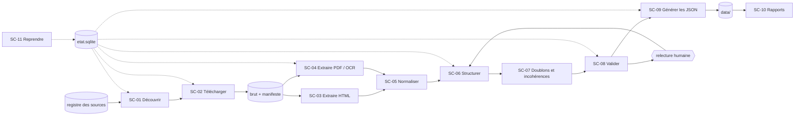

# Scrpt — Architecture des scripts de collecte et schéma des données

| | |
|---|---|
| **Version** | 0.1 — 19 octobre 2026 |
| **Rôle** | spécifier les scripts Python à développer et la forme exacte des fichiers JSON produits |
| **Statut** | conception : **aucun script n'est développé dans cette phase** |
| **Documents liés** | [`AnalyseData.md`](./AnalyseData.md) (sources) · [`Outil.md`](./Outil.md) (bibliothèques) · [`Bloquage.md`](./Bloquage.md) (obstacles) · [`Plan.md`](./Plan.md) §11–§13 (backend, modèle, données fictives) |

## Sommaire

- [1. Vue d'ensemble du pipeline](#s1)
- [2. Arborescence](#s2)
- [3. Schéma JSON commun](#s3)
- [4. Représentation des données manquantes et non vérifiées](#s4)
- [5. Spécification des scripts](#s5)
- [6. Règles transverses](#s6)
- [7. Cohérence du schéma et intégration au backend](#s7)
- [8. Ordre de développement](#s8)

---

<a id="s1"></a>
## 1. Vue d'ensemble du pipeline



**Principe.** Chaque document traverse des **étapes**. Chaque étape lit une entrée identifiée par son empreinte SHA-256 et écrit une sortie identifiée de la même façon. L'état de chaque document et de chaque étape est enregistré dans `etat.sqlite`. Le pipeline peut s'arrêter n'importe où et repartir sans rien refaire d'inutile (SC-11).

**Ce qui n'est jamais automatique** : passer une donnée au statut `verifie_humain` ou au-dessus, ajouter une source au registre, corriger une table de glyphes.

---

<a id="s2"></a>
## 2. Arborescence

### 2.1 Deux zones séparées

| Zone | Contenu | Versionnée dans git ? |
|---|---|---|
| `collecte/` | code, configuration, fichiers bruts, intermédiaires, état, journaux | code et configuration : **oui** ; brut, intermédiaire, état, journaux : **non** (`.gitignore`), archivés à part |
| `data/` | **sortie publiée** : référentiels, programmes JSON, registre des sources, rapports | **oui** : c'est l'entrée du backend |

### 2.2 `collecte/`

```text
collecte/
├── pyproject.toml              # uv, Python 3.12, dépendances verrouillées
├── uv.lock
├── config/
│   ├── sources.yaml            # registre maître (§5, SC-01) — édité par un humain
│   ├── politesse.yaml          # délais par domaine, user-agent, fenêtres horaires
│   ├── selecteurs/<source>.yaml   # sélecteurs CSS/XPath par source (SC-03)
│   ├── glyphes/<sha256>.yaml      # table de correspondance par document (SC-05)
│   └── alias/                  # libellés vus → codes canoniques (SC-05)
│       ├── annees.yaml
│       ├── matieres.yaml
│       └── filieres.yaml
├── src/collecte/
│   ├── __main__.py             # `uv run python -m collecte <commande>`
│   ├── commun/                 # http, robots, etat, journal, empreinte, modeles (Pydantic)
│   ├── sc01_decouvrir/         # projet Scrapy (spiders par source)
│   ├── sc02_telecharger.py
│   ├── sc03_extraire_html.py
│   ├── sc04_extraire_pdf.py
│   ├── sc05_normaliser.py
│   ├── sc06_structurer.py
│   ├── sc07_doublons.py
│   ├── sc08_valider.py
│   ├── sc09_generer.py
│   ├── sc10_rapports.py
│   └── sc11_reprendre.py
├── tests/                      # tests unitaires + documents de référence
├── benchmark/                  # 20 pages transcrites à la main (Outil.md §12.4)
├── brut/<source_id>/<sha256>.<ext>   # non versionné
├── brut/manifeste.jsonl              # une ligne par fichier téléchargé
├── intermediaire/<sha256>/           # texte par page, mots positionnés, tableaux, OCR
├── revue/                            # fichiers de relecture humaine (SC-08)
├── etat.sqlite
└── journaux/<run_id>.jsonl
```

### 2.3 `data/` — adaptée au système scolaire marocain

Les noms de dossiers utilisent les **codes officiels** (1AP, 1AC, TC, 1Bac, 2Bac), en minuscules et sans accents.

```text
data/
├── schema/
│   ├── programme.schema.json          # généré depuis Pydantic (SC-08)
│   └── referentiel.schema.json
├── referentiel/
│   ├── niveaux.json                   # PRIMAIRE, COLLEGE, LYCEE
│   ├── annees.json                    # 1AP…6AP, 1AC…3AC, TC, 1BAC, 2BAC
│   ├── filieres.json                  # filières et options du lycée, avec leur année
│   ├── matieres.json                  # codes stables + libellés ar/fr
│   └── langues.json                   # ar, fr, zgh, en, es, de, it
├── sources/
│   └── registre.json                  # sources D-xx publiées (sans les URL privées)
├── primaire/
│   ├── 1ap/
│   │   ├── arabe.json
│   │   ├── amazighe.json
│   │   ├── francais.json
│   │   ├── mathematiques.json
│   │   ├── activite_scientifique.json
│   │   ├── education_islamique.json
│   │   ├── education_artistique.json
│   │   ├── education_physique.json
│   │   ├── competences_de_vie.json
│   │   └── anglais.json               # existe avec statut "manquant" (AnalyseData V-01)
│   ├── 2ap/ … 3ap/                    # même liste
│   └── 4ap/ … 6ap/                    # + sciences_sociales.json
├── college/
│   ├── 1ac/ 2ac/ 3ac/                 # arabe, francais, anglais, mathematiques, physique_chimie, svt, …
├── lycee/
│   ├── tc/
│   │   ├── _commun/                   # programmes identiques pour plusieurs filières du TC
│   │   ├── sciences/
│   │   ├── technologies/
│   │   ├── lettres_sciences_humaines/
│   │   └── enseignement_originel/
│   ├── 1bac/
│   │   ├── _commun/
│   │   ├── sciences_experimentales/
│   │   ├── sciences_mathematiques/
│   │   ├── sciences_technologies_electriques/
│   │   ├── sciences_technologies_mecaniques/
│   │   ├── sciences_economiques_gestion/
│   │   └── lettres_sciences_humaines/
│   └── 2bac/
│       ├── _commun/
│       ├── sciences_experimentales/
│       │   ├── _commun/               # commun aux options PC, SVT, agronomie
│       │   ├── pc/
│       │   ├── svt/
│       │   └── sciences_agronomiques/
│       ├── sciences_mathematiques/
│       │   ├── _commun/
│       │   ├── a/
│       │   └── b/
│       └── …                          # autres filières, créées seulement quand une source existe
└── rapports/
    ├── couverture.json
    ├── couverture.md                  # tableau lisible, régénéré (remplace AnalyseData §7 à terme)
    └── erreurs.json
```

**Règles de placement.**
1. Un fichier = **un programme** d'une matière, pour une année, et pour une filière ou une option quand elles existent.
2. Un programme identique pour plusieurs filières est stocké **une seule fois**, dans le `_commun/` **le plus proche** qui contient toutes ces filières. Sa liste `portee.filieres` les nomme explicitement. On ne duplique jamais un fichier.
3. Un dossier de filière n'est créé que si au moins un programme y est **sourcé**. Un dossier vide n'est jamais une promesse de couverture.
4. L'option internationale (BIOF, etc.) **n'est pas** un dossier : c'est la valeur `langues_enseignement` (AnalyseData §9).
5. Les données d'un programme **adapté** (D-03, D-04) vont dans le même fichier que le programme normal, avec `programme.type = "adapte"`. Quand le programme normal sera disponible, il **remplacera** la version adaptée, qui restera dans l'historique.

---

<a id="s3"></a>
## 3. Schéma JSON commun

### 3.1 Principes

- **Une seule définition** : les modèles Pydantic de `collecte/src/collecte/commun/modeles.py`. `data/schema/programme.schema.json` en est **généré**, jamais écrit à la main.
- **Vocabulaire officiel conservé** : `domaines`, `themes`, `objectifs`, comme dans D-02 (المجالات، المواضيع، أهداف التعلم). Le rapprochement avec les tables du backend (`units`, `chapters`) se fait à l'import (§7), pas dans le fichier.
- **Contenu et calendrier séparés** : `domaines` décrit **quoi** apprendre ; `organisation_temporelle` décrit **quand** (unités de 5 semaines, séances).
- **Texte en ordre logique** Unicode NFC, jamais en ordre visuel.
- **Pas de traduction inventée** : si la source est en arabe seulement, `fr` vaut `null`. Une traduction machine n'est jamais stockée comme texte du programme.
- **Chaque élément porte sa provenance et son état.**

### 3.2 Structure d'un fichier programme

```json
{
  "schema_version": "1.0.0",
  "id": "primaire.2ap.mathematiques",
  "niveau":  { "code": "PRIMAIRE" },
  "annee":   { "code": "2AP" },
  "matiere": { "code": "MATHEMATIQUES" },
  "portee":  { "filieres": [], "options": [], "commun": false },
  "langues_enseignement": {
    "valeur": ["ar", "fr"],
    "etat": "officiel_miroir",
    "provenance": [{ "source_id": "D-02", "page": 45, "methode": "pypdf" }]
  },
  "programme": {
    "type": "officiel",
    "intitule": { "ar": "المنهاج الدراسي للتعليم الابتدائي", "fr": null },
    "version": "2021-07",
    "date_effet": { "valeur": null, "etat": "manquant" },
    "vigueur": "presume_en_vigueur"
  },
  "volume_horaire_hebdo_min": {
    "valeur": 300,
    "etat": "extrait_non_verifie",
    "provenance": [{ "source_id": "D-02", "page": 45, "methode": "pypdf" }]
  },
  "organisation_temporelle": {
    "valeur": {
      "unites": { "nombre": null, "duree_semaines": 5, "semaines_apprentissage": 4, "semaines_evaluation_soutien": 1 },
      "seances_par_semaine": 5,
      "duree_seance_min": 60
    },
    "etat": "extrait_non_verifie",
    "provenance": [{ "source_id": "D-02", "page": 289, "methode": "pypdf" }]
  },
  "competences": [],
  "domaines": [
    {
      "id": "primaire.2ap.mathematiques.d01",
      "position": 1,
      "intitule": { "ar": "الأعداد والحساب", "fr": null },
      "etat": "corrige_humain",
      "provenance": [{ "source_id": "D-02", "page": 302, "methode": "pypdf+table_glyphes", "extrait_brut": "الأعداد واحل~ساب" }],
      "themes": [
        {
          "id": "primaire.2ap.mathematiques.d01.t01",
          "position": 1,
          "intitule": { "ar": "الأعداد من 0 إلى 99", "fr": null },
          "etat": "corrige_humain",
          "provenance": [{ "source_id": "D-02", "page": 302, "methode": "pypdf+table_glyphes" }],
          "sous_themes": [],
          "objectifs": [
            {
              "id": "primaire.2ap.mathematiques.d01.t01.o01",
              "position": 1,
              "texte": { "ar": "يتعرف القيمة المكانية لأرقام عدد معين (الوحدات والعشرات)", "fr": null },
              "etat": "corrige_humain",
              "cle": "sha1:…",
              "provenance": [{ "source_id": "D-02", "page": 302, "methode": "pypdf+table_glyphes", "extrait_brut": "يتعرف القيمة املكانية لأرقام عدد معني:(الوحدات والعررشات )" }]
            }
          ]
        }
      ]
    }
  ],
  "sources": [
    {
      "id": "D-02",
      "titre": "المنهاج الدراسي للتعليم الابتدائي — الصيغة النهائية الكاملة",
      "organisme": "Direction des curricula",
      "url_collecte": "https://www.ostad.ma/wp-content/uploads/2021/07/…pdf",
      "url_officielle": null,
      "sha256": "c9d5fdb0e74a690a…",
      "date_collecte": "2026-10-19",
      "confiance": "A-m"
    }
  ],
  "manques": [
    { "champ": "competences", "raison": "non encore extraites de D-02 p. 272-300", "action": "SC-06 sur la section mathématiques", "bloquage": null },
    { "champ": "programme.date_effet", "raison": "aucune date d'entrée en vigueur dans D-02", "action": "demande à la Direction des curricula", "bloquage": "B-02" },
    { "champ": "organisation_temporelle.unites.nombre", "raison": "valeur visible dans le tableau p. 288, non encore vérifiée", "action": "contrôle visuel", "bloquage": "B-08" }
  ],
  "validation": {
    "statut": "en_revue",
    "historique": [
      { "date": "2026-10-19", "acteur": "SC-09", "action": "genere" }
    ]
  },
  "meta": { "genere_par": "SC-09 0.1.0", "run_id": "…", "empreinte_contenu": "sha256:…" }
}
```

> **Les valeurs de cet exemple ne sont pas des données de production.** Elles montrent la forme du fichier. Le domaine, le thème et l'objectif viennent de D-02 p. 302, **reconstitués à la main** à partir d'un texte abîmé ; l'état `corrige_humain` reflète exactement cela. Les volumes et l'organisation dans le temps sont `extrait_non_verifie` (AnalyseData §6).

### 3.3 Champs

| Champ | Type | Obligatoire | Règle |
|---|---|---|---|
| `schema_version` | semver | oui | version du schéma, pas du programme |
| `id` | chaîne | oui | `<niveau>.<annee>[.<filiere>[.<option>]].<matiere>`, minuscules ; identique au chemin du fichier |
| `niveau.code`, `annee.code`, `matiere.code` | code | oui | doit exister dans `data/referentiel/` ; les libellés sont **dans le référentiel**, pas répétés |
| `portee` | objet | oui | lycée : `filieres` non vide ; primaire et collège : listes vides ; `commun: true` seulement dans `_commun/` |
| `langues_enseignement` | Champ<liste de codes> | oui | §4 |
| `programme.type` | enum | oui | `officiel` · `adapte` · `cadre_reference` |
| `programme.version` | chaîne | oui | date ou version du **document source** (`2021-07`, `2024-01-adapte`) |
| `programme.vigueur` | enum | oui | `en_vigueur_verifie` · `presume_en_vigueur` · `remplace` · `temporaire` |
| `volume_horaire_hebdo_min` | Champ<entier> | oui | minutes par semaine |
| `organisation_temporelle` | Champ<objet> | non | calendrier, séparé du contenu |
| `competences[]` | liste | oui (peut être vide **avec** une entrée dans `manques`) | `type` : `cycle` · `annuelle` · `finale` |
| `domaines[].themes[].sous_themes[]` | liste récursive | non | profondeur maximale 2 |
| `objectifs[]` | liste | oui (idem) | une phrase de la source = un objectif ; jamais reformulé |
| `objectifs[].cle` | empreinte | oui | hash du texte normalisé (clé CAMeL) : sert à suivre un objectif d'une version à l'autre même si sa position change |
| `provenance[]` | liste | oui sur chaque élément | `source_id`, `page`, `methode`, `extrait_brut` (texte tel qu'extrait, 300 caractères au maximum) |
| `sources[]` | liste | oui, non vide | copie des entrées du registre utilisées par ce fichier |
| `manques[]` | liste | oui | §4 |
| `validation.statut` | enum | oui | `brouillon` · `en_revue` · `verifie_humain` · `valide_enseignant` · `rejete` |

### 3.4 Fichiers du référentiel

`annees.json` (extrait de forme ; les libellés réels viennent de D-02, D-04 et D-06) :

```json
{
  "schema_version": "1.0.0",
  "annees": [
    { "code": "1AP", "niveau": "PRIMAIRE", "position": 1, "libelle": { "ar": "السنة الأولى ابتدائي", "fr": "1re année du primaire" }, "alias": ["1ère Primaire", "CP", "P1", "الأول ابتدائي"], "sources": ["D-02"] }
  ]
}
```

Les **alias** (`collecte/config/alias/*.yaml`) relient chaque libellé rencontré au code canonique, par exemple « 1ère Primaire » (AlloSchool), « CP » (Bewize), « P1 » (IMEL) et « الأول ابتدائي ». Un libellé inconnu **bloque** la normalisation (SC-05) au lieu d'être deviné.

`filieres.json` liste, pour chaque filière : `code`, `annee`, `parent` (option → filière), libellés, `sources`, et `statut_cartographie` (`cartographiee` · `identifiee`). Les filières non scientifiques sont `identifiee` tant qu'aucun programme n'est collecté (AnalyseData §7.4).

---

<a id="s4"></a>
## 4. Représentation des données manquantes et non vérifiées

### 4.1 Le type `Champ`

Toute valeur simple qui peut manquer ou être incertaine est enveloppée :

```json
{ "valeur": <valeur ou null>, "etat": "<etat>", "provenance": [ … ] }
```

| `etat` | Sens | `valeur` | `provenance` |
|---|---|---|---|
| `verifie_source` | lu dans un document officiel obtenu à une adresse officielle (A) | renseignée | obligatoire |
| `officiel_miroir` | lu dans un document officiel obtenu par un miroir (A-m) | renseignée | obligatoire |
| `extrait_non_verifie` | extrait automatiquement, pas encore relu | renseignée | obligatoire |
| `corrige_humain` | corrigé ou confirmé par un relecteur à partir de la source | renseignée | obligatoire + entrée dans `validation.historique` |
| `manquant` | la source ne donne pas l'information, ou aucune source n'est disponible | `null` | facultative |
| `non_applicable` | l'information n'existe pas pour ce cas (exemple : filière au primaire) | `null` | aucune |
| `contradictoire` | deux sources se contredisent | `null` | obligatoire, avec **toutes** les sources en conflit |

Les **éléments de liste** (domaines, thèmes, objectifs, compétences) portent directement `etat` et `provenance`.

### 4.2 Règles

1. **`null` n'est jamais muet.** Toute valeur `null` (hors `non_applicable`) a une entrée dans `manques[]`, avec `champ`, `raison`, `action` et, si besoin, l'identifiant `B-xx`.
2. **Une liste vide n'est jamais muette.** Une liste obligatoire vide exige une entrée dans `manques[]`. Sinon, SC-08 la rejette.
3. **Aucun remplissage par défaut** : pas de 0, de chaîne vide ni de valeur « probable ».
4. **Un fichier peut exister avec un programme entièrement manquant** (exemple : `anglais.json` au primaire). C'est ce qui permet au rapport de couverture d'afficher **∅** plutôt que de faire disparaître la matière.

---

<a id="s5"></a>
## 5. Spécification des scripts

Chaque script est une commande de `python -m collecte`. Toutes partagent `commun/` (HTTP, état, journal, modèles).

### SC-01 — Découvrir et inventorier les sources

| | |
|---|---|
| **Objectif** | tenir le registre des sources et lister les URL candidates (documents, pages) sans les télécharger en entier |
| **Entrées** | `config/sources.yaml` (écrit par un humain : identifiant `D-xx`/`P-xx`, domaine, type, confiance, licence, méthode de découverte, autorisée ou non) ; sitemaps ; pages de catégories ; API (CKAN de data.gov.ma) |
| **Sorties** | table `urls` de `etat.sqlite` (url, source_id, type attendu, découverte_le, statut `decouvert`) ; `data/sources/registre.json` (partie publique) |
| **Bibliothèques** | Scrapy (spiders `sitemap`, `categorie`), Protego, lxml ; scrapy-playwright si la source l'exige et l'autorise |
| **Fonctionnement** | 1) lit `robots.txt` et le met en cache 24 h ; 2) lit les sitemaps déclarés ; 3) parcourt les catégories avec un sélecteur par source ; 4) ne garde que les URL qui correspondent à un motif autorisé (exemple : `*.pdf` sous `/assets/documents/` pour AlloSchool) ; 5) enregistre sans télécharger le contenu (requête `HEAD`, ou seulement la page de liste) |
| **Validations** | source présente dans le registre et `autorisee: true` ; URL autorisée par `robots.txt` ; domaine dans la liste blanche ; pas d'URL de connexion ou de compte |
| **Erreurs** | 403, 429 (arrêt du domaine, réessai plus tard selon `Retry-After`) ; sitemap invalide ; boucle de redirection ; défi anti-robot détecté (page Cloudflare, redirection obfusquée) → **arrêt immédiat** de la source + `B-xx` |
| **Dépendances** | aucune en amont ; alimente SC-02 |

### SC-02 — Télécharger les pages et documents

| | |
|---|---|
| **Objectif** | récupérer les fichiers des URL `decouvert`, une fois, poliment, avec leur empreinte |
| **Entrées** | URL de statut `decouvert` ou `a_rafraichir` ; `config/politesse.yaml` |
| **Sorties** | `brut/<source_id>/<sha256>.<ext>` ; une ligne dans `brut/manifeste.jsonl` (url, url finale, statut HTTP, en-têtes utiles : `Content-Type`, `Content-Length`, `Last-Modified`, `ETag` ; sha256 ; taille ; date) ; statut `telecharge` |
| **Bibliothèques** | httpx, Hishel, Tenacity, PyrateLimiter, Protego, hashlib |
| **Fonctionnement** | file par domaine, une requête à la fois par domaine ; délai = max(`Crawl-delay`, valeur de `politesse.yaml`, 10 s par défaut) ; requête conditionnelle (`If-None-Match`, `If-Modified-Since`) ; écriture dans un fichier temporaire, puis empreinte, puis renommage atomique ; si l'empreinte existe déjà, simple lien vers le fichier connu (même PDF sur plusieurs miroirs) |
| **Validations** | type MIME cohérent avec l'extension et la signature (`%PDF-`) ; taille > 0 et < plafond (100 Mo) ; PDF ouvrable ; PDF minuscule ou sans page → `suspect` (exemple : D-05, `B-12`) |
| **Erreurs** | délais dépassés, erreurs 5xx (réessais avec backoff, au plus 5) ; 404 (statut `disparu`, alerte si c'était une source officielle) ; TLS (on ne désactive **jamais** la vérification : `B-19`) ; DNS (`B-01`) |
| **Dépendances** | SC-01 |

### SC-03 — Extraire le contenu HTML

| | |
|---|---|
| **Objectif** | transformer une page en données utiles : liens de documents, métadonnées, texte principal, structure de navigation (année, matière, section) |
| **Entrées** | fichiers HTML bruts ; `config/selecteurs/<source>.yaml` |
| **Sorties** | `intermediaire/<sha256>/html.json` (titre, langue, date déclarée, fil d'Ariane, liens typés, texte principal) ; nouvelles URL candidates renvoyées vers SC-01 |
| **Bibliothèques** | parsel, lxml, trafilatura ; BeautifulSoup en secours |
| **Fonctionnement** | sélecteurs déclaratifs par source (pas de code spécifique éparpillé) ; trafilatura pour les pages d'annonce ; le fil d'Ariane donne les libellés bruts d'année et de matière, normalisés ensuite par SC-05 |
| **Validations** | chaque sélecteur obligatoire trouve au moins un résultat, sinon `selecteur_casse` (le site a changé) ; encodage déclaré cohérent (ftfy en dernier recours) |
| **Erreurs** | page de défi ou de connexion reçue au lieu du contenu ; mise en page modifiée ; **données personnelles** détectées (§6.3) → écartées de la sortie |
| **Dépendances** | SC-02 |

### SC-04 — Extraire les PDF, avec OCR si nécessaire

| | |
|---|---|
| **Objectif** | produire pour chaque page : texte, mots positionnés, tableaux, et un texte OCR de contrôle quand il le faut |
| **Entrées** | PDF bruts |
| **Sorties** | `intermediaire/<sha256>/` : `meta.json` (pages, signets, producteur, dates, chiffrement), `pages/NNN.pypdf.txt`, `pages/NNN.mots.json` (pdfplumber : mot, x0, x1, top, bottom, police), `pages/NNN.tableaux.json`, `pages/NNN.ocr.txt` (si OCR), `diagnostic.json` |
| **Bibliothèques** | pypdf, pdfplumber, pypdfium2, Tesseract (via pytesseract ou appel direct), OCRmyPDF ; Docling seulement s'il gagne le banc d'essai (Outil.md §12.4) |
| **Fonctionnement** | 1) **diagnostic par page** : présence d'une couche texte, part de caractères arabes et latins, part de formes de présentation, part de caractères suspects (chiffres collés à des lettres arabes, `~`, `�`) ; 2) **classement** de la page : `texte_sain`, `texte_abime`, `image_seule` ; 3) `texte_sain` → pypdf + mots positionnés ; `texte_abime` → les mêmes + OCR de contrôle (rendu pypdfium2 à 300 dpi, Tesseract `ara+fra`) ; `image_seule` → OCR seul ; 4) tableaux : regroupement des mots par colonnes selon x (de droite à gauche pour l'arabe), puis par lignes selon y |
| **Validations** | nombre de pages égal à celui du `meta` ; aucune page oubliée ; score de confiance OCR enregistré ; écart texte/OCR mesuré (distance d'édition) et signalé au-delà d'un seuil |
| **Erreurs** | PDF chiffré ou protégé (`B-xx`, aucun contournement) ; PDF corrompu (pypdf reconstruit la table xref, ce qui est noté dans le diagnostic) ; tifinagh sans OCR (`B-11`) ; temps de traitement trop long (OCR par lots, reprise page par page) |
| **Dépendances** | SC-02 |

### SC-05 — Normaliser niveaux, années, matières, filières et texte

| | |
|---|---|
| **Objectif** | produire un texte propre et des **codes canoniques** à partir des libellés bruts |
| **Entrées** | sorties de SC-03 et SC-04 ; `config/glyphes/<sha256>.yaml` ; `config/alias/*.yaml` ; `data/referentiel/*.json` |
| **Sorties** | `intermediaire/<sha256>/normalise/` : texte normalisé par page (NFC) ; libellés résolus (`"1ère Primaire" → 1AP`) ; liste des libellés **non résolus** |
| **Bibliothèques** | `unicodedata` (NFKC puis NFC), CAMeL Tools (clés de comparaison), ftfy |
| **Fonctionnement** | 1) NFKC sur les formes de présentation ; 2) table de glyphes **propre à chaque document** (D-02 : « 5س »→« س », « 8ص »→« ص », « ررش »→« شر », lam-alef), écrite et relue par un humain, appliquée seulement au document dont l'empreinte correspond ; 3) nettoyage des en-têtes et pieds de page répétés (« مديرية المناهج، يوليوز 2021 ») ; 4) résolution des alias ; 5) calcul d'une **clé de comparaison** (sans diacritiques, alif et ya unifiés), utilisée pour les doublons, **jamais affichée** |
| **Validations** | après correction, plus aucun caractère suspect (sinon la page reste `texte_abime`) ; tout libellé d'année, de matière ou de filière est résolu (sinon **blocage** du document, pas de devinette) ; aucune perte de caractères (contrôle de longueur avant et après) |
| **Erreurs** | table de glyphes absente pour un document abîmé → le document attend une relecture ; alias ambigu (un libellé → deux codes) → blocage |
| **Dépendances** | SC-03, SC-04 |

### SC-06 — Structurer les programmes

| | |
|---|---|
| **Objectif** | construire l'arbre domaines → thèmes → (sous-thèmes) → objectifs, ainsi que les compétences, le volume horaire et l'organisation dans le temps |
| **Entrées** | textes et tableaux normalisés ; **profil de document** `config/profils/<source_id>.yaml` (où commence chaque matière, quelles pages sont les programmes annuels, quelles colonnes portent quel champ) |
| **Sorties** | `intermediaire/<sha256>/structure/<programme_id>.json` (même schéma que la sortie finale, avec `etat: extrait_non_verifie`) |
| **Bibliothèques** | Pydantic (modèles), règles en Python pur |
| **Fonctionnement** | le **profil** découpe le document : par exemple, pour D-02, signets → matière, titres « برنامج السنة الثانية » → année, tableaux à 3 colonnes → domaine / thème / objectifs. Une cellule vide de la colonne domaine prolonge le domaine précédent (cellules fusionnées). Chaque élément garde sa page et son extrait brut. Rien n'est créé sans une ligne de source. |
| **Validations** | chaque objectif a un thème et chaque thème un domaine ; positions continues ; aucun texte de source « orphelin » (le texte non affecté est listé pour relecture) ; nombre d'années attendu par matière (1AP–6AP, ou 4AP–6AP pour les sciences sociales, selon D-02 p. 34) |
| **Erreurs** | tableau coupé sur deux pages (fusion par profil) ; colonnes inversées (détection : la colonne la plus courte en texte est le domaine) ; structure non reconnue → `a_structurer_manuellement` |
| **Dépendances** | SC-05 |

### SC-07 — Détecter les doublons et les incohérences

| | |
|---|---|
| **Objectif** | éviter les doublons entre sources et repérer les contradictions |
| **Entrées** | fichiers bruts (empreintes), structures de SC-06, référentiels |
| **Sorties** | `intermediaire/doublons.json` ; `intermediaire/incoherences.json` ; mise à jour des états `contradictoire` |
| **Bibliothèques** | hashlib, datasketch (MinHash LSH sur le texte normalisé), RapidFuzz |
| **Fonctionnement** | 1) **fichiers** : même SHA-256 = même fichier ; MinHash > 0,9 = même document dans une autre version (recompressé, page ajoutée) → on garde celui de plus haute confiance et on relie les autres comme miroirs ; 2) **éléments** : thèmes ou objectifs presque identiques dans un même programme (RapidFuzz ≥ 95) → doublon probable ; 3) **incohérences** : volume horaire différent selon deux sources, matière présente dans une source et absente d'une autre (exemple : AnalyseData V-01 à V-05), programme adapté pris pour le programme normal, même programme dans deux filières sans passer par `_commun/` |
| **Validations** | une fusion n'est jamais automatique entre deux sources de confiance différente sans trace ; tout conflit A/A-m contre B/C se résout en faveur de A, avec la source B gardée en `provenance` de recoupement |
| **Erreurs** | faux positifs sur des objectifs voisins mais différents (« يقرأ الأعداد من 0 إلى 99 » ≠ « … إلى 999 ») : seuil élevé et comparaison des nombres extraits |
| **Dépendances** | SC-06 |

### SC-08 — Valider les données et leur provenance

| | |
|---|---|
| **Objectif** | ne laisser passer vers `data/` que des données conformes au schéma et traçables, et organiser la relecture humaine |
| **Entrées** | structures de SC-06, corrigées par SC-07 ; fichiers de relecture `revue/*.yaml` |
| **Sorties** | rapport de validation ; `data/schema/*.schema.json` (régénéré) ; fichiers de relecture pour les éléments `extrait_non_verifie` (une ligne par élément : extrait brut, image de la zone de page, proposition) |
| **Bibliothèques** | Pydantic, jsonschema, pypdfium2 (vignette de la zone source) |
| **Fonctionnement** | 1) validation de schéma ; 2) règles métier (§4.2, codes du référentiel, `portee` cohérente avec le dossier, provenance vers une source du registre, empreinte de la source présente dans le manifeste) ; 3) génération de la file de relecture ; 4) intégration des décisions humaines (`corrige_humain`, `valide_enseignant`, `rejete`), avec nom du relecteur et date dans `validation.historique` |
| **Validations** | 100 % des éléments ont une provenance ; aucune `valeur` sans `etat` ; aucun `null` sans `manques` ; `sources[]` cohérent avec les `source_id` utilisés |
| **Erreurs** | décision de relecture sur un élément qui a changé depuis (clé différente) → la décision est rejetée et l'élément revient en relecture |
| **Dépendances** | SC-07 ; relecture humaine |

### SC-09 — Générer les fichiers JSON

| | |
|---|---|
| **Objectif** | écrire `data/` de façon déterministe |
| **Entrées** | structures validées ; référentiels |
| **Sorties** | `data/<niveau>/<annee>/…/<matiere>.json` ; `data/referentiel/*.json` ; `data/sources/registre.json` |
| **Bibliothèques** | Pydantic (`model_dump_json`), json |
| **Fonctionnement** | tri stable des clés et des listes (par `position`) ; indentation fixe ; encodage UTF-8 sans échappement de l'arabe ; écriture atomique ; `meta.empreinte_contenu` calculée sur le contenu hors `meta` : un fichier n'est **réécrit que si son contenu change** (diff git lisible) ; création des fichiers « manquants » attendus par le référentiel (exemple : `anglais.json`) |
| **Validations** | revalidation de chaque fichier écrit contre `programme.schema.json` ; chemin = `id` ; aucun fichier hors arborescence prévue |
| **Erreurs** | conflit de chemin (deux programmes avec le même `id`) → arrêt |
| **Dépendances** | SC-08 |

### SC-10 — Produire les rapports de couverture et d'erreurs

| | |
|---|---|
| **Objectif** | savoir à tout moment ce qui est couvert, avec quel niveau de confiance, et ce qui bloque |
| **Entrées** | `data/**/*.json`, `etat.sqlite`, `journaux/*.jsonl` |
| **Sorties** | `data/rapports/couverture.json` et `couverture.md` (matrice niveau × année × filière × matière, avec F / P / R / ∅ / NA comme AnalyseData §7) ; `erreurs.json` (par source et par étape : nombre, type, dernier exemple, `B-xx` lié) ; résumé de la dernière exécution |
| **Bibliothèques** | DuckDB (requêtes sur les JSON et les journaux) |
| **Fonctionnement** | F = programme `officiel` dont ≥ 90 % des objectifs sont au moins `corrige_humain` ; P = `adapte`, ou extrait mais non relu ; R = seulement des sources B/C ; ∅ = fichier « manquant » ; NA = matière absente du référentiel pour cette année |
| **Validations** | le rapport compte autant de cellules que le référentiel prévoit de combinaisons |
| **Erreurs** | aucune bloquante (rapport en lecture seule) |
| **Dépendances** | SC-09 (et l'état de toutes les étapes) |

### SC-11 — Reprendre une collecte interrompue

| | |
|---|---|
| **Objectif** | relancer seulement ce qui n'est pas terminé ou ce qui a changé |
| **Entrées** | `etat.sqlite` |
| **Sorties** | relance des étapes concernées ; résumé (repris, sautés, en échec définitif) |
| **Bibliothèques** | SQLite, Scrapy `JOBDIR` pour SC-01 |
| **Fonctionnement** | table `etapes(document_sha256, etape, version_script, empreinte_entree, statut, tentatives, derniere_erreur, maj_le)`. Une étape est **sautée** si son entrée et la version du script n'ont pas changé et que son statut est `ok`. Elle est **relancée** si elle a échoué avec une erreur transitoire et qu'il reste des tentatives. Elle est **mise de côté** (`attente_humaine`) si l'erreur est permanente (403, défi anti-robot, table de glyphes manquante). Un verrou de fichier empêche deux exécutions en même temps. |
| **Validations** | après une reprise, aucun document dans un état intermédiaire incohérent (exemple : `extrait` sans fichier intermédiaire) |
| **Erreurs** | base d'état corrompue → restauration depuis la sauvegarde de la veille (copie de `etat.sqlite` à chaque fin d'exécution) |
| **Dépendances** | toutes |

### Résumé des dépendances

| Script | Dépend de | Nourrit |
|---|---|---|
| SC-01 | registre humain | SC-02 |
| SC-02 | SC-01 | SC-03, SC-04, SC-07 |
| SC-03 | SC-02 | SC-01 (nouvelles URL), SC-05 |
| SC-04 | SC-02 | SC-05 |
| SC-05 | SC-03, SC-04 | SC-06 |
| SC-06 | SC-05 | SC-07 |
| SC-07 | SC-06 | SC-08 |
| SC-08 | SC-07, relecture | SC-09 |
| SC-09 | SC-08 | data/, SC-10 |
| SC-10 | SC-09, état | rapports |
| SC-11 | état | toutes les étapes |

---

<a id="s6"></a>
## 6. Règles transverses

### 6.1 Politesse et légalité

- **User-agent** explicite : `TeachMe-collecte/<version> (+<url du projet>; <adresse de contact à définir>)`.
- `robots.txt` respecté pour chaque URL, `Crawl-delay` appliqué, **10 s minimum** entre deux requêtes sur un même domaine, une seule connexion par domaine.
- Collectes de nuit (heure du Maroc) pour les sites publics ; plafond quotidien de requêtes par domaine dans `politesse.yaml`.
- **Aucun contournement** : pas d'imitation d'empreinte TLS, de proxy rotatif, de solveur de captcha ni de session volée. Une source protégée passe en `attente_humaine` avec un `B-xx`.
- Une source n'entre dans `sources.yaml` avec `autorisee: true` qu'après la vérification de ses conditions d'utilisation (AnalyseData §4). Pour les plateformes privées, `autorisee` se limite au **repérage** (`portee_autorisee: reperage`) : leurs contenus ne sont pas extraits.

### 6.2 Provenance

- Chaque fichier brut est identifié par son SHA-256 et décrit dans `manifeste.jsonl`.
- Chaque élément d'un JSON pointe vers une source du registre, une page et l'extrait brut.
- Les fichiers bruts ne sont jamais modifiés. Toute correction se fait dans les étapes suivantes et reste tracée.

### 6.3 Données personnelles

- **Pas de collecte** des portails personnels (Massar, comptes élèves).
- Les documents d'enseignants peuvent contenir un nom, une école ou un téléphone (exemple lu : la répartition annuelle sur AlloSchool, `B-10`). SC-03 et SC-04 détectent les motifs « اسم الأستاذ », « الأستاذ(ة) : », « المؤسسة : », « Nom de l'enseignant », ainsi que les adresses e-mail et les numéros de téléphone. Ces champs ne sont **jamais** copiés dans `intermediaire/` ni dans `data/`.
- Ces documents ne sont pas téléchargés par défaut : seuls les documents **officiels** le sont. Si l'un d'eux est récupéré pour un recoupement, son fichier brut est conservé hors du dépôt, puis supprimé après 90 jours.
- Les journaux n'enregistrent ni contenu de document ni donnée personnelle : seulement des URL, des empreintes et des codes d'erreur.

### 6.4 Qualité du code

- Python 3.12, `ruff` et `mypy --strict` sur `src/`, tests `pytest`.
- Tests sur des **pages de référence** (benchmark) : une régression d'extraction fait échouer la CI.
- Chaque script est idempotent et sans effet de bord hors de ses dossiers de sortie.

---

<a id="s7"></a>
## 7. Cohérence du schéma et intégration au backend

### 7.1 Garantir la cohérence entre les fichiers

| Mécanisme | Détail |
|---|---|
| Source unique du schéma | modèles Pydantic → `data/schema/*.schema.json`, versionnés avec `schema_version` |
| Validation en CI | chaque PR qui touche `data/` valide **tous** les fichiers ; elle échoue si un fichier ne passe pas, si un code n'existe pas dans le référentiel, ou si un `null` n'a pas d'entrée dans `manques` |
| Versionnement du schéma | semver : un **patch** ajoute une description ; une **mineure** ajoute un champ facultatif ; une **majeure** renomme ou retire un champ. Une majeure exige une migration de tous les fichiers dans la même PR. |
| Écriture déterministe | SC-09 seul écrit `data/` ; une édition manuelle d'un JSON est refusée par la CI (empreinte `meta` incohérente) |
| Contrats partagés avec le backend | le JSON Schema est copié dans `packages/contracts` (Plan.md §11.4) et converti en types et validateurs Zod côté NestJS : un seul contrat pour les deux langages |

### 7.2 Correspondance avec le modèle de données de Plan.md §12

| JSON | Table du backend (Plan.md §12.3) | Remarque |
|---|---|---|
| `referentiel/niveaux.json` | `levels` | — |
| `referentiel/annees.json` | `grades` | `alias` non importés |
| `referentiel/matieres.json` | `subjects` | ajouter **compétences de vie** (AnalyseData V-02) |
| `referentiel/filieres.json` | `tracks` | `parent` pour les options (PC, SVT, SM A/B) : **colonne à ajouter** (`parent_track_id`) |
| `portee`, `volume_horaire_hebdo_min` | `grade_subjects` (`weekly_hours`) ; `track_subjects` | `weekly_hours` en heures dans Plan.md → **stocker plutôt des minutes** (8 h 30, 30 min) |
| `langues_enseignement` | — | **colonne à ajouter** sur `grade_subjects` / `track_subjects` (AnalyseData V-04) |
| `programme` (type, version, vigueur) | `curricula` (`code`, `version`, `effective_from`, `status`) | `type = adapte` → `status = temporaire` |
| `domaines[]` | `units` | `units.objectives` reste vide : les objectifs sont au niveau du thème |
| `themes[]` | `chapters` | `sous_themes` : soit `chapters` imbriqués, soit aplatis (**décision du Lot 2**) |
| `objectifs[]` | **table à ajouter** `learning_objectives` (`chapter_id`, `position`, `text_ar`, `text_fr`, `key`, `status`) | aujourd'hui `chapters.objectives` (texte) ne permet ni de suivre ni de valider un objectif |
| `competences[]` | **table à ajouter** `competencies` | — |
| `provenance[]`, `sources[]` | **table à ajouter** `sources` + `source_refs` (polymorphe ou par table) | Plan.md prévoit `lessons.source_id` seulement |
| `manques[]` | `content_gaps` | déjà prévue dans Plan.md |
| `validation.statut` | `content_status` | seul un programme `valide_enseignant` peut être importé en `valide` ; sinon il arrive en `brouillon` |

Ces ajouts sont reportés dans `Plan.md` §12 (19/10/2026, ADR-008 proposé) et seront créés au Lot 2.

### 7.3 Import

- Script d'import côté backend (Lot 2), **idempotent** : il compare `meta.empreinte_contenu` et `objectifs[].cle` pour mettre à jour sans recréer.
- Mode `--dry-run` obligatoire avant chaque import réel, avec un rapport des créations, modifications et retraits.
- Un objectif qui disparaît d'une nouvelle version passe en `retire`, jamais supprimé (Plan.md §12.5).
- Le seed Prisma n'importe que les **référentiels** (Plan.md §12.7). Les programmes passent par l'import contrôlé.

---

<a id="s8"></a>
## 8. Ordre de développement

| Étape | Livrable | Condition pour passer à la suite |
|---|---|---|
| 1 | Environnement `uv`, modèles Pydantic, schéma exporté, `sources.yaml` avec D-02 à D-07 | schéma relu ; registre conforme à AnalyseData |
| 2 | Banc d'essai d'extraction (Outil.md §12.4) | combinaison d'extracteurs choisie, chiffres publiés |
| 3 | SC-02 + SC-04 + SC-11 sur **D-02 seul** | 556 pages diagnostiquées, reprise testée par une interruption volontaire |
| 4 | SC-05 + table de glyphes de D-02 + SC-06 sur **mathématiques 1AP–6AP** | arbre complet ; relecture humaine de 100 % des objectifs |
| 5 | SC-07 à SC-10 | premiers fichiers `data/primaire/*/mathematiques.json` validés en CI ; rapport de couverture |
| 6 | Extension aux autres matières du primaire | V0 primaire : toutes les cellules F ou ∅ justifiées |
| 7 | SC-01 (Scrapy) pour le repérage, puis D-04 et D-03 | filières scientifiques en statut `adapte` |
